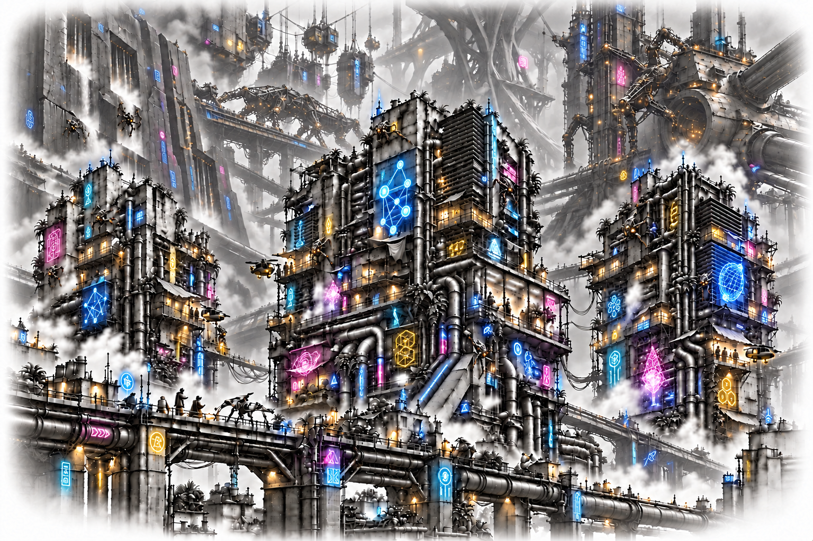

# The Hours We Keep

***An original illustrated cyberpunk novella about workers reclaiming control of their learned intelligence, and the costs of making that freedom usable.***[^fiction]

[Read the illustrated PDF](output/pdf/final/The%20Hours%20We%20Keep%20with%20appendix.pdf) · [Read the editable text](The%20Hours%20We%20Keep.md)

## A future we can still shape

Lowreach, 2189. Mara wakes in a body she doesn’t recognize, with a day missing from her memory and work she cannot afford to refuse. In the city’s lower streets, even a lifetime of hard-earned skill can disappear behind an unpaid bill.

Then the company that controls her work offers her a way out: a steady salary, her housing debt cleared, a future she could finally stop worrying about. The price reaches into everything she and Kite, her AI companion, have learned together. Around a battered repair kitchen, Mara and her friends begin taking jobs on their own terms. Each repair brings in a little money. Each success gives them more to lose.

High water is coming. The city is about to hand still more control to the company, and the people who keep its machinery running are running out of time to prove they can survive without surrendering themselves.

[^fiction]: This review edition uses Lowreach as a provisional city name. Its people, corporations and technologies are fictional.
