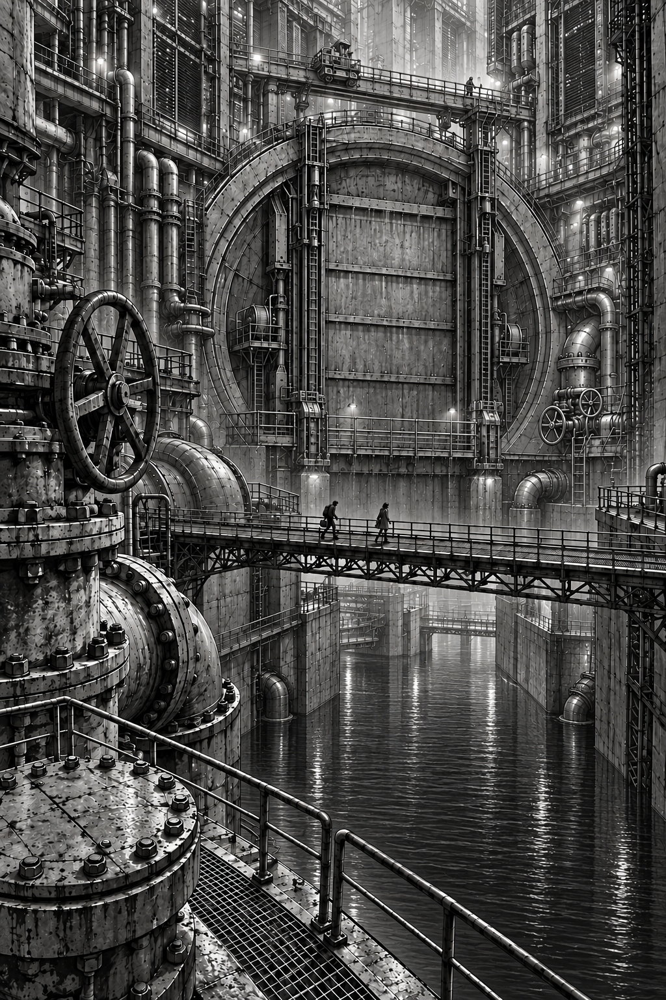
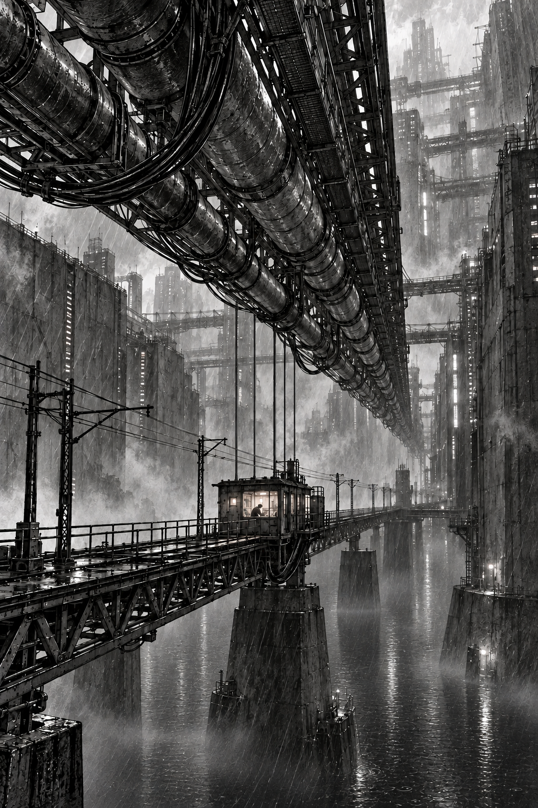
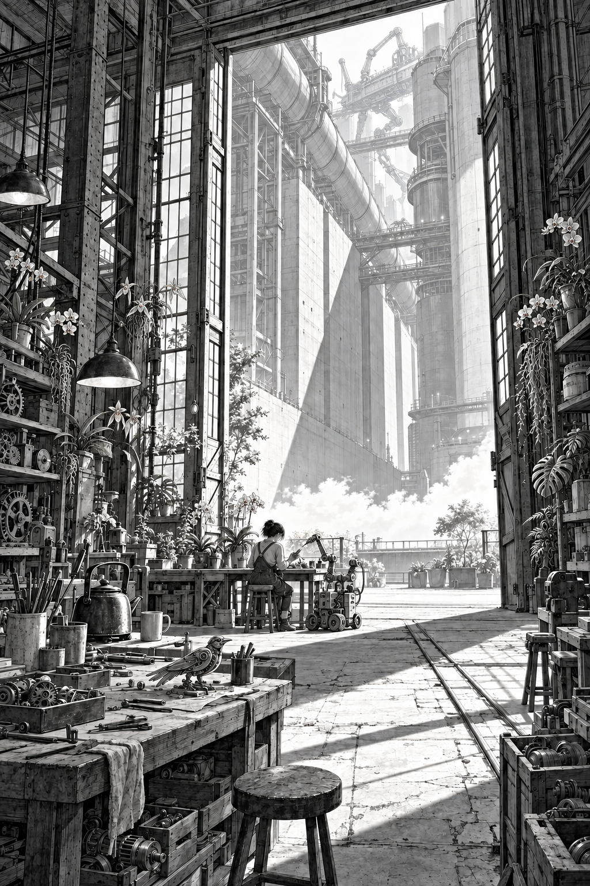

# The Hours We Keep

A cyberpunk novella set in Lowreach, a city beneath corporate-owned towers of computation.

*The lights went out by floor, but the counting never stopped.*

Reader revision draft; Lowreach is a provisional city name.

## Contents

[Introduction](#introduction)

How corporate nurseries and licensed education made dependence an ordinary condition of life.

[1. Small Defect](#chapter-1)

Mara investigates a pump fault her employer dismisses, while unfamiliar sensations and a missing day make her question what happened to her.

[2. The Unbilled Hour](#chapter-2)

At the repair kitchen, everyday disputes reveal the difference between memory and usable intelligence, and why earning independently requires more than owning a record.

[3. City Beneath the City](#chapter-3)

Beneath Lowreach's polished forecasts, Mara and Sef find a way to challenge the takeover, while Kite insists that companionship does not erase privacy.

[4. A Different Customer](#chapter-4)

A cold-store job tests whether independent work can pay, exposing dangerous misunderstandings between machines and the financial pressure waiting after their first success.

[5. The Price of Quiet](#chapter-5)

Offered security in exchange for silence, Mara must face an earlier betrayal and decide which choices she can make for herself and Kite.

[6. Intake Nine](#chapter-6)

An authorized inspection uncovers troubling discrepancies beneath the city's reassuring reports, but helping a trapped worker forces Mara to risk more than discovery.

[7. Current Debt](#chapter-7)

As Vesper squeezes their livelihoods, the workers build an independent power supply and discover why several agreeing machines can still make one dangerous mistake.

[8. What We Carry](#chapter-8)

The cooperative tests shared intelligence on everyday work, asking whose labour counts, what consent requires, and whether greater capability should mean greater control.

[9. The Cost of a Map](#chapter-9)

A seizure at the depot exposes the consequences of a secret bargain, leaving the group to decide what accountability and rebuilding demand of them.

[10. Nobody Comes Alone](#chapter-10)

From borrowed rooms and salvaged equipment, Mara gathers commitments, confronts old debts, and tests whether people can reclaim the keys to their own minds.

[11. Weather for Machines](#chapter-11)

With the surge arriving early, the cooperative prepares to prove its limited promises while Mara confronts the risks of keeping Kite's judgment independent.

[12. The Shape of a Door](#chapter-12)

During the live test, rising water and conflicting instructions force Mara to weigh trust, safety, and who has the right to accept a risk.

[13. The Hours We Keep](#chapter-13)

In the storm's aftermath, the struggle turns to individual claims and unfinished obligations, while Mara faces what records can preserve and what they cannot.

[14. A Morning of Their Own](#chapter-14)

Six weeks later, ordinary work tests the freedoms they sought, as Mara discovers what it might mean to have time that belongs to her.

[Appendix: What Is Already Here?](#appendix-what-is-already-here)

A bounded evidence map separates documented ingredients, partial analogues and the story’s speculative leaps.

## Introduction

The city grew around the pumping stations. On the first maps, its streets were narrow lines between fields reclaimed from the tide. Later maps showed housing over the fields, roads over the housing, and districts whose daylight depended on the structures above them.

The company nurseries came after the floods. They promised healthy bodies and an education for every citizen. Governments already borrowing from their operators signed the contracts. Within three generations, most people were grown. The public allowance bought the smallest education package. Those with money could purchase the rest.

Families who still bore their own children received food credits and basic tools. The companies funding the programme kept first offers on whatever those children learned to do. A talent discovered in a flooded cellar could pay a distant office for years.

The law protected a citizen's name and memories. An expired account could still take away the skill to read a wiring plan. The record of yesterday's work would remain.

Below the streets, the Stackholds' buried computer halls ran through the night. Their cooling pipes passed through the foundations of buildings whose names had been forgotten. Far above, the high terraces were beginning to catch the sun.

The water pressed against the gates. Somewhere in the lower city, a kettle began to boil.

# Chapter 1
## Small Defect

Mara woke with her tongue against a tooth that should have been broken.

She moved it back and forth. Smooth enamel, a sharp new edge. She opened her eyes.

The ceiling above her was painted tram-depot green. A curtain hung around the narrow bed, with a gap at the foot.

A trolley rattled past the gap. One wheel knocked with each turn. Somewhere beyond the curtain, onions were frying.

She sat up too quickly. Her hand went past the bed rail and closed on air.

"A little to the left," Kite said.

The voice came from a small ceramic case hanging from the lamp beside her. She had known that voice for nine years. Mara reached again, watching her hand this time. The fingers were longer. There was no white notch across the knuckle where a slipping wrench had struck her seventeen years ago.

"What happened to my hand?"

"Your reach needs calibration. Dax has the orientation record. May I show you?"

Beyond the curtain someone laughed. Mara could remember eating an apple on the tram, worrying a bit of peel loose from her bad tooth. Yesterday morning. After that, nothing she could put a proper edge around.

Her wrist display waited on the bedside table. She picked it up and found a payment warning.

"What do we owe?"

"Mara."

"How much?"

Kite told her. She put her feet on the floor. Even her soles felt insufficiently used.

Dax, who ran the depot repair kitchen, came through the curtain with tea. He looked older than he had yesterday, and when he saw her standing he put the mug down with both hands.

"Sit a minute. Please."

"There's a pump repair job. I have to take it before two."

"The continuity group can wait for your sleeve maintenance contribution."

"Sleeve?"

"Your body," Dax said. "This one's new. The group paid for it."

She looked at her hands. The words passed through her like a dropped tool through dark water. Somewhere below, she knew, they would strike bottom.

"Eli's coming," Dax said. "We can go through the record with him."

"I'll wait for him." She looked up. "I can still do the job."

"That isn't in question."

"Then let me have something I know."

He rubbed his jaw. At last he said he would take her himself. They would do the balance checks first. No climbing, no live work, and if her new hands stopped where she expected them to keep moving, she was to tell him.

She agreed too quickly. He made her say it again.

* * *

The pump was earning four hundred and twelve credits an hour. Mara was earning nothing until she agreed it worked.

Dax had brought her to a drainage vault beneath Silt, the low district around the depot. She knelt beside the isolated shaft housing while he watched the lockout indicator. Brown water heaved below the sump grating. A strip on her wrist counted the minutes she had rented the diagnostic channel. Nine minutes, forty-three seconds. The charge beneath it rose more smoothly than the water.

"Again," Kite said.

"I heard it."

"You heard the pump. I would like to hear the washer."

She moved the contact probe a finger's width. Her filter collar caught the warm mist blowing off the cooling pipes. Kite's seed, the little ceramic case now hanging from her neck, tapped her breastbone. Its weight, at least, was right.

"There."

Three turns of the shaft on the test motor, four. A small blunt tick arrived between the larger beats.

"Bearing cage?"

"Possibly. I practiced separating overlapping vibrations while you were on the tram. That could also be a loose mounting clip."

"Yesterday?"

"Yesterday. Just after your checkpoint."

She held the probe still.

"You practiced on whose money?"

"Local computation. I became very slow at counting the stops."

Vesper, the corporation that allocated her repair jobs, compared the recording with its approved examples. VARIATION WITHIN SAFE ENVELOPE. REASSEMBLE AND RELEASE.

Mara requested an extension. Additional investigation, the service informed her, would be discretionary.

"Meaning unpaid."

Dax reached around her and checked the probe cable, giving her time to decide.

"Show me the cost of a cage failure," she said.

"For which party?" Kite asked.

She laughed once. It came out higher than she expected.

A human supervisor joined the channel. Behind his face a ceiling fan turned, and a child shouted somewhere outside the frame. He listened to the recording twice.

"It's below threshold," he said.

"At this load."

"That's the test load."

"High water's due in five days."

"I know when high water's due, Venn. I've got a ground-floor mother. Can you certify an immediate risk?"

An intermittent knock might last a month. It might end at the next restart. Kite offered an estimate, then crossed it out because the sample was too small.

"I can certify that the cover needs to come off."

The man rubbed his face. "Mark your exception. I can't give you the time."

He stayed on the channel while she broke the paint seal. She appreciated that more than she wanted to.

The bearing cage had a hairline crack along one pocket. Stationary, it almost disappeared. She wiped oil across it and flexed it gently; the line filled black.

The supervisor authorized a replacement. The first eighteen minutes remained discretionary. A new warning explained that dismantling without prior approval had lowered her completion score.

Beyond the mesh wall, a freight lift descended through the city. Its passing lamps lit the cavern underneath: concrete piers sinking into darkness, cooling pipes thick as tramcars, walkways that disappeared before reaching their other ends. This was only the outer service vault of the Stackhold above Intake Nine. She had worked around its edges since she was sixteen and had never seen the far wall.

Two people stood across the void. Their inspection lights looked like sparks caught in a drain.

"You learned something useful," she told Kite, packing the old bearing.

"Yes."

"Keep it."

"The practice is mine. The fault example belongs to this service record. I have separated them."

Dax held the gate open. Going through, she struck her unfamiliar elbow against the frame. It hurt with complete conviction.

* * *

Eli was waiting in the depot's recovery alcove. He rose when she entered, then stopped, his hands hanging awkwardly at his sides.

"Don't," she said.

"I haven't done anything."

She looked at his face. He was her younger brother, with the scar on his chin she remembered making, accidentally, with a toy crane. His face had not changed. Something in it had.

He sat back down. On the bedside table, his dismantled radio lay beside the tea she had left. He had brought it here to give his hands work.

Mara touched her new tooth.

"Tell me."

Kite asked permission to show her the record. This time she gave it.

There was a witness statement. Rook Street underpass. A gang collector demanding the key to her privately held repair skills instead of money, with two boys at his back to make asking mean something else. The statement gave the argument six lines and her death one.

"Last evening," Kite said. "The witness knew you. Your private checkpoint is from that morning. The continuity group held it under your instructions. You had authorized restoration if the body could not be saved."

"This body."

"This one was available," Eli said. His voice caught on available, and he began again. "Dax called them. We checked your consent."

Mara looked down at her hands. She remembered signing the directive years earlier, irritated by the number of separate permissions. Her parents' people had been particular about ownership. Down in the old streets, that was one of the ways they annoyed the government. She had thought it was another form for a disaster that happened to somebody else.

"Am I a copy?"

Kite was quiet long enough that she heard the trolley wheel in the kitchen.

"You are the current Mara," it said. "Your soul was restored from the checkpoint you owned. I recognize you. I cannot give you the day you lost."

Eli covered his face. She put her strange hand against his wrist, and he caught it.

A notice lit her display. Vesper wanted acknowledgment of the new continuity terms for Tomorrow, its city-service system, due to launch in five days.

Kite read them while she sat with her brother.

"There is a custody clause," it said at last. "It applies to running identities. Yours as well as mine."

Mara looked from the smooth skin of her hand to the small worn seed. She had been back in the world for six hours. Somebody had already found a cleaner way to take what she knew.

# Chapter 2
## The Unbilled Hour

By morning, Mara had read the amendment five times and slept badly between readings. She carried it through the recovery curtain to Dax, who had a printer, a kettle and a talent for fitting trouble between meals. Her new feet slid inside her old boots.

The old tram depot smelled of onions and flux. Along one wall, people repaired portable heaters for the coming wet season. Along the other, a woman in a kitchen apron argued with a benefits terminal while her small daughter slept across two chairs.

"Your maintenance contribution can wait," Dax said. He was cutting bread with a salvaged serrated blade. "The group owns the sleeve. Nobody's taking it off you."

"Rent won't wait."

"No. Have bread."

"Have you accepted Tomorrow?"

"I haven't accepted today."

She showed him. His face settled as he read.

At the heater bench, a young repairer pushed a schematic away.

"I fitted six of these in March. I remember the house. Purple curtains, dog pissing on my bag. But that means nothing."

He pointed at the circuit symbol beneath his finger. His trade-capability license had expired overnight. The life record remained his to replay; the learned interpreter that made this particular drawing useful sat behind a payment demand.

Dax brought him a little reader. "Community module. Different supplier. We own this license. Want to try it?"

The repairer agreed. He followed the unfamiliar prompts slowly, then returned to the schematic.

"That's the cutoff?"

"Check it," Mara said.

He did. This time he knew what the marks asked him to do.

"Whose skill is that?" she asked Dax.

"People who agreed to teach it. Nobody's life included. It can test a heater without knowing who had the dog."

Mara touched her temple. She had kept expecting yesterday to return when she found the right association.

"My missing day didn't take the repair work with it."

"A recording of a repair is storage," Kite said. "A repair skill is a set of learned processes that can run. One can survive without the other. Your established capability was preserved. Companies have become very good at charging for the processes while assuring people they own the recordings."

The repairer was already bent over the heater. He would have to learn this module's ways. At least tomorrow it would still be there.[^1]

At the terminal, the woman demanded, "They have the hours. They sent me the hours. Why do I have to send them back?"

Dax looked over. "Nessa's three employers disagree about whether she exists on a Tuesday."

"I exist very hard on Tuesdays," Nessa said.

Like most people in Lowreach, Nessa had begun in a company-grown sleeve with a public education allowance. Hers bought Foundation Care: coordination, basic literacy, a trade primer. Better arithmetic cost extra. Nessa had learned the complicated work afterward, from other carers and the people she washed. The company still described it as development of its educational product.

She worked in domestic care. Two visits crossed midnight; the third agency calculated shifts in its head office's time zone. Her childcare allowance had stopped because the records showed both an impossible overlap and a day without work. Contesting the overlap required a statement she could obtain only by closing the contest.

Mara sat beside her. "Can Kite look? Just these letters and your shifts."

Nessa glanced at the ceramic seed. "Does it send them somewhere?"

"Only where you approve," Kite said. "I can prepare an answer here. I will need this terminal's spare processing."

"It hasn't got much," Dax said.

"I shall try to match its ambition."

Nessa gave permission. Onscreen, Kite laid the visits along a single local-time line. She watched the midnight entries move.

"There," she said sharply. "That's what I told them."

A second pane offered Mara renewal of her own talent-support stipend. It had recognized her wrist display. She closed it before accepting the required practice upload.

"Still getting that?" Nessa asked.

"Trying to."

Naturally born, dissident-family registration, mechanical aptitude: the categories followed her from childhood. Government support had bought meals and a basic tool kit. In return the corporate funders got first offers on what she learned using them. Enough food to keep producing examples. Never enough money to buy freedom from the arrangement.

"You came with your own schooling," Nessa said.

"I came with my mum. She knew how to read a bad contract. I should've listened harder."

On Nessa's work schedule, the false blank day disappeared. A twenty-minute overlap remained.

"Travel time," Nessa said. "They paid travel for once. It counts as a visit in that agency's thing."

Kite asked for the relevant payslip. It did not ask for her care notes, though the portal offered those too. Mara kept a hand near the screen while Nessa selected what could be opened.

Pell, who kept the repair kitchen's accounts and arranged its deliveries, came in carrying a dented cash tin. "If that terminal charges her for an appeal, unplug it. I need the socket."

"It doesn't," Kite said. "But the appeal would be the wrong action. Her agencies can correct their returns. I have prepared separate requests, with a common attachment showing the discrepancy. Nessa, please check the visits."

She read every one. When she reached Tuesday, she touched its hours with two fingers as though they were a bruise.

"Those are right."

She approved the three messages. The terminal gave her three receipts and, after a pause, one provisional reinstatement from an office whose rules accepted a pending employer correction. The money had not arrived. The red suspension notice, however, became a dated review.

Nessa sagged back in her chair.

"I was going to spend my lunch getting on the phone," she said.

"An hour?" Mara asked.

"If they answered."

Kite closed the files. "Permission to retain the general method for reconciling midnight shifts? No names or care details."

Nessa said yes.

Her daughter woke when Nessa bent to put on her shoes. They left with bread wrapped in an old tram timetable. Through the depot doors, Mara watched them turn toward the little stretch of waterfront where people fished despite the warning signs. The girl was still holding a shoe in one hand.

Then Pell put the cash tin down. "Very nice. Our electricity account doesn't accept happiness."

* * *

Sef, a former Vesper systems visualizer who now took netrunning work around the depot, arrived in a charcoal office jacket with silver patches on its elbows. Their trousers had once belonged to someone considerably taller. They had turned the excess cloth into sharply pressed cuffs.

They read Mara's amendment standing up.

"Where's yours?" Mara asked.

"I refused the preliminary version. Moth disliked the verbs."

Moth, Sef's personal intelligence, spoke through the small earpiece under their collar. "I disliked the undefined objects."

Dax fetched chairs. Pell cleared a space beside the cash tin, then put the tin back in the middle where everyone had to see it.

Sef compared three amendments whose owners had authorized them to inspect the terms. Different openings, identical definitions. A clinic assistant's licensed scheduling practice. A seam repairer's measuring skill. Kite's fault diagnosis. The new language reached each by the same narrow bridge of clauses.

"But we own our souls," Dax said.

"On paper," Sef said. "Who holds Nessa's usable backup key? The company. Who can afford a new sleeve without its plan? We barely managed one. Mara's private checkpoint is the exception."

Mara looked at her hands. "We can't withdraw rights we already sold them."

"We don't need to," Sef replied. "Tomorrow wants what comes next. Improved methods. New practice. Everyone still teaching their souls how to live."

"So we stop teaching?" Dax asked.

"We stop giving optional new licenses," Pell said. "If we can afford to. And don't sign this."

She tapped the tin. "That second sentence has a cost."

During the last contract stoppage Mara had put a price on refusal. Six days without work, rent advancing, Eli between crews. Then a retention payment if she remained available. She had accepted and told the others she was living on savings.

Dax pushed a mug toward her. "You're white. Eat something."

She tore a corner from the bread and could not swallow it.

Sef opened the municipal transition register. Its design predated Vesper's ownership of the service portal. It had actual page numbers.

"There is one thing," they said. "I used to draw this for people who were paid not to understand it."

Conditions appeared beneath a cheerful diagram of a city changing operators.

"External witness," Sef said. "Before a new control system takes over, the operator must show a functioning fallback and disclose contested rights in the systems being transferred."

"A complaint box," Mara said.

"A gate. A limited one. Existing contracts keep running. But Vesper can't certify a clean transition while concealing unresolved claims."

"And if somebody proves that?" Pell asked.

"The city can defer the handoff. Require another demonstration. Split the service contracts if someone else can actually do the work."

Dax looked at the bread knife and the terminal's scorched cable.

"How competent?"

"More than this looks," Pell said. "Possibly less than we are."

Pell had a job in mind. The Tern cold-store cooperative needed two failing condenser banks inspected and a loading schedule rebuilt before the tide disrupted deliveries. Vesper offered a monthly optimization package. Tern wanted its vegetables cold and its drivers home.

"They'll talk to me because I used to dispatch their night loads," Pell said. "They'll pay after a witnessed test. No advance. No promise of more."

Mara checked the terminal's available capacity.

"We haven't got enough rented capacity for a whole warehouse."

"Then we'll find out what we actually need," Pell said.

Sef turned the transition register toward Mara. At the bottom, a small grey link offered an authorized maintenance visualization.

"First, come and look at the gate."

# Chapter 3
## City Beneath the City

That afternoon in the depot, Sef gave Mara a pair of scratched immersion lenses and a stool with all four feet.

"No walking," they said. "You'll try."

"I know a picture from a floor."

"Everybody says that."

The public maintenance viewer accepted her ordinary contractor credential. Sef made her inspect the permissions before entering: read published maintenance geometry, inspect transition specifications, run demonstration scenarios. Nothing that moved real machinery.

"I've got enough people trying to bill me for existing," she said. "I'm not buying a city by accident."

The depot disappeared.

She stood at the edge of a municipal cavern, looking down through twenty stacked floors. Far beneath her, luminous water represented data moving between city systems. Structural piers contained the history of equipment, each inspection a thin ring inside the concrete. Somewhere overhead was the street, represented by a low lid of ash-colored cloud. It seemed far less substantial than everything supporting it.

People had once needed these pictures to understand the city. Now most service souls read the underlying records directly, leaving a geography nobody bothered to demolish.

Sef stood beside her in their office jacket. They had kept the patched elbows.

"You drew this?"

"The inspection layers. Somebody much better did the water."

A maintenance vessel passed beneath them, small enough to rest in Mara's palm at this scale. Its wake consisted of pending work orders. Along the cavern wall, dark squares opened into the Stackholds, each a corporation-owned mountain of running thought. Most doors bore the same white Vesper mark.

Mara looked for the pump she had repaired. Its indicator shone green inside a tiny arrangement of tubes. From here the machinery that had bruised her elbow was almost too small to select.

"It makes us look tidy," she said.

"That's one of the dangers."

Sef lowered them through the floors. Mara's stomach believed the descent before the rest of her did. Her unfamiliar toes curled inside her boots.

At the bottom of the cavern stood a square frame, so large its top vanished into the stacked levels above. Tomorrow's proposed control system occupied the far side as a pale, unfinished city, arranging and rearranging its streets. The frame itself was old municipal work. Lines of dark lettering ran down its pillars.

Moth spoke softly. "Demonstration environment confirmed."

Sef submitted an imaginary operator to the city's handoff test. It had excellent efficiency projections, an impeccable company seal and no functioning fallback. The huge opening filled with a fine grey mesh.

TRANSITION REQUIREMENTS UNMET.

"Now watch what counts," Sef said.

They supplied a tiny certified demonstration: one pump, one local controller, a human able to stop it. The mesh withdrew across a space the size of a doorway. The rest stayed closed.[^2]

Mara leaned forward.

"That little bit is all it gets?"

"What it proved. If the rights are uncontested. If the witness accepts the evidence. This is how the rule is supposed to behave."

"And Vesper can't just erase it?"

"It can dispute it. Demand tests. Get the city to change its contracts later. Today the condition still exists, and the witness desk is outside Vesper's control. Don't make it bigger than it is."

Mara reached toward the doorway. The system asked what she wished to inspect. Her hand remained a picture, obedient to her old body's remembered proportions. For the first time since waking, she could point without thinking.

* * *

The contested-rights register resembled a wall of narrow storage drawers. Most bore dates and case numbers. A few were open, displaying public statements from owners who objected to Tomorrow's new custody terms.

Sef asked for the transition summary. It reported no unresolved restrictions affecting service availability.

"That's a different question," Mara said.

"Yes."

They opened a drawer whose owner had made the complaint public. A laundry worker had refused the indefinite license for a fabric-sorting method she had taught her soul. Vesper's answer confirmed that no interruption to her existing services was expected. Her refusal remained unanswered.

The summary counted the case as resolved. Sef entered `compare: claim / resolution` in the viewer's query field. Most drawers dimmed. This one stayed lit.

"How many?" Mara asked.

Moth counted the visible records, then stopped. "The published sample does not establish the total."

Sef saved the case reference and its conflicting classification. The drawer stayed where it was.

"Enough to ask the witness a precise question," they said. "Not enough to prove the whole transition unsafe. We'll need owners willing to sign their own refusals. And the original test records, to check the safety claims."

Mara called up Intake Nine in the viewer. A recorded trial appeared as a clean band around one enormous pier, but the layer for its original readings was empty. She selected it and received a retention notice: original safety readings held locally pending reconciliation.

She knew the old instruments. Their signed records lived in cabinets bolted to the machinery they measured, partly because the sea was an excellent argument against depending entirely on a distant server.

"I can read those with maintenance access," she said. "At the intake."

"Then that's where we verify. We don't fill the gap with what we'd like to find."

Above them, Tomorrow's pale city rearranged itself again. A bridge vanished. Three efficient towers rose in its place.

Mara thought of the boys at Rook Street demanding her repair-skill key. She had no memory of their faces. A company could make its demand so gently that the threat looked like weather.

"Could someone lift private memory through one of these skills?" she asked.

"A properly separated skill carries its method and provenance," Kite said. "It need not carry the memories that produced it. Bad separation is possible. So is a dishonest agreement. That is why we inspect both."

"Your private memories from yesterday," Mara said. "Show me."

A small consent mark appeared beside Kite's voice. Its Morals, the rules that enforced its agreed limits, had registered a boundary. No amount of work credit would move it.

"No," Kite said.

She felt the answer in her new jaw.

"You were there."

"I have shared the account of what happened. My private responses stay in my own drawer."

"It's my death."

"Yes. I won't withhold facts about it. That doesn't make every thought I had available."

Sef looked away, an ordinary courtesy in an impossible room.

Mara stared at the immense floor below them. She wanted the lost day with a hunger that made any scrap seem like food.

"They restored me," she said. "You must have a copy somewhere. Of the day."

"A record is not your experience of it. Your checkpoint preserved earlier learning. It could not preserve what had not yet reached it. Mine works that way too."

She knew this. Knowing had become a different activity lately.

"All right," she said.

Kite did not thank her. After a moment it asked whether she wanted to save their pump-diagnosis method locally before leaving the rented channel.

She said yes.

Sef lifted the lenses from her face. The depot returned around her, too small and full of smells. Someone had left a bowl of soup by her elbow. On the surface, a skin had formed while they were underneath the city.

# Chapter 4
## A Different Customer

Later that day, they went to the Tern cold store on timber piles behind a wholesale market. Its manager met them with a thermometer and no enthusiasm.

"Pell says you can do this without a subscription."

"Pell says many beautiful things," Dax said.

Pell ignored him. She laid out the job on the lid of a packing crate: inspect both condenser banks, repair what could be repaired within the agreed parts limit, stagger incoming loads so that the doors spent less time open. Payment after a witnessed temperature test. Tern could keep and use the schedule. Any rights to the crew's later improvements would need a separate agreement.

The manager examined the paper. "Who's responsible if it goes warm?"

"For a repair fault, us," Mara said. "For a driver propping the door open with a cabbage, your driver. We'll record which is which."

The woman almost smiled. She signed.

Inside, the cold hit Mara's new teeth. Rows of vegetables gave off a sweet, earthy smell beneath the sharper odor of disinfectant. Someone had taped a photograph of a beach over a damaged door seal.

The first condenser needed a contactor. The second had a faulty vibration damper, close enough to yesterday's problem that Kite could adapt its practiced test. Mara did the work under Dax's inspection. She disliked having her hands watched, then caught herself and handed him the torque gauge without being asked.

Pell worked dispatch beside the loading doors. Sef and Moth linked the cold store's inventory reader and refrigeration controller to Pell's proposed schedule. Three independent services could now agree which truck belonged where. They shared a loading-bay status for every truck.[^3]

For eleven minutes, the arrangement worked perfectly.

Then a temperature alarm sounded in the second cold room.

The cold-store controller reported every door closed. Through the glazed panel, Mara could see one standing wide open. On the controller's plan, it was Door Four.

"Shut Four," she said.

"Four is shut," Pell answered from dispatch.

Warm air poured over the nearest stack. Dax moved to the open door. A pallet blocked it, and a worker on the other side was trying to pull the pallet clear without tipping its boxes.

Mara reached for the controller's override.

"That permission is for diagnosis," Kite said.

"Then ask for the other one."

Kite asked the manager. Mara had wanted it to be quicker than asking. She heard her own breath and waited through the answer.

The manager authorized temporary control of the affected bank. Kite increased the cooling while Dax and the worker shifted the pallet. The door shut, but the warm air already inside still had to be cooled. The temperature continued climbing.

"Why isn't the schedule stopping arrivals?" the manager demanded.

Pell held up a hand to an approaching driver and stood in his path until he braked.

Sef stared at the two displays. "The inventory reader says Four is closed because Four's manifest is complete. That's a load status. We mapped it to a door."

Nobody had lied. Everything had answered the question it thought it had been asked.

Mara pulled a roll of tape from her pocket. "Then we go and look."

They walked the bays. She put a large hand-lettered number on each physical door. Pell drew a new dispatch sheet using those numbers. Until they had checked every mapping, a human would confirm each closure on the radio. Pell entered `dispatch: wait for door check`. The next truck's arrival box stayed amber until Dax reported the door shut.

The manager watched Dax climb down from the final label.

"Your clever system needs a person saying a door's shut?"

"Today it does," Pell said. "The subscription quote needed a person too. They put it on page eight."

The second room cooled slowly. The crew ate bread beside the refrigeration pipes while the manager checked the temperature with her own thermometer. Mara liked her for that.

At the end of the test, Tern paid two hundred and eighty-six credits.

Pell deducted the agreed parts and power costs. What remained would not rescue anybody. It was, however, money a customer had paid for work, arriving without an intermediate company deciding how much of the work had happened.

Mara watched her share enter her account.

"Do that again," she said.

"I can't make it pay twice," Pell said.

"Just show me."

Pell did.

* * *

Nineteen people stayed at the depot after supper. Someone had chalked the first job's costs on a board. Dax erased the word profit and replaced it with remainder until Pell could explain which expenses they had forgotten.

A heater repairer wanted everyone to put their souls into one common service. It would be cheaper than all these separate rentals, he said. Better answers too.

"Possibly," Sef said. "We managed to misunderstand a door with only three services."

"So test it."

"Yes. With permission."

Mara sat on the edge of a workbench, turning the old cracked bearing cage in her hands. She could feel each sharp place now without looking at her fingers. That small victory had arrived while nobody was measuring it.

Dax proposed a seven-day cooperative trial. A small elected committee would sign only the jobs the group could actually perform. Every participating worker would see the accounts. Nobody would own a founder's share. Essential maintenance already promised to the city would continue.

"And no compulsory pooling," Mara said.

The heater repairer frowned. "We can vote on how we use our equipment."

"You can't vote Kite into something. Or me."

She felt the room look at her new face. For once she let it.

Kite stated its own boundary. It would license the general vibration method for the trial, with provenance intact. Its private memory would remain private. Moth gave a narrower permission for scheduling verification. Other people and souls asked for time to decide.

The vote authorized the trial. It authorized nobody's participation by default.

Pell collected the consent records separately from the member list. "We are currently rich enough to own one clipboard," she said. "Please don't celebrate by losing it."

Mara went outside to call Eli. The depot's broken sign swung above her in air that smelled of approaching rain. Across the district, windows lit the sides of the Stackholds in thin service lines. Most of the huge surfaces stayed dark.

Before Eli answered, her rented computation channel slowed.

Kite's next word took nearly two seconds to arrive.

"Audit."

A Vesper notice followed. Outside commercial activity had triggered a review of shared capacity. Under standard arrears provisions, her account would receive only the minimum service until outstanding balances were settled or the review ended.

Her housing account issued its own notice. Usually Vesper deducted her rent from future job earnings. It had stopped advancing that money. A payment was due within forty-eight hours.

The little sum from Tern sat beneath the demand, absurdly inadequate.

Eli answered. Behind him she heard the radio hissing through the tide forecast.

"How'd it go?"

She looked back into the depot. Dax was washing bowls. Pell had everyone leaning over the arithmetic. For a moment Mara almost told him it had been a stupid idea.

"We got paid," she said. "There's trouble after it."

"There usually is. Tell me."

She sat on the step to explain. Tomorrow would launch in four days. Her rent came due before it.

# Chapter 5
## The Price of Quiet

The lift dried Mara's shirt before she reached the terraces.

Air came through little slots beside the floor indicator, cool enough to raise bumps along her arms. It was her third morning in the community-grown replacement body. The arms responded properly; she still expected the scar on her left wrist. The missing day remained missing. She had stopped checking it whenever she woke. Mostly.

At reception, a woman offered her water in a glass so thin she could feel the cold through it immediately. Mara took a second glass when the woman looked away. Then she was annoyed with herself for behaving as if water upstairs might contain something better.

Iona Rusk, Vesper's director of municipal continuity, met her without an assistant. She wore a pale jacket with an old-fashioned pen clipped inside the pocket. Beyond the meeting room, trees grew in long beds raised to waist height. Each leaf was still. Nursery plaques listed gene edits for salt spray and metal dust. The terrace glass kept the wind outside with the rest of the weather.

"Thank you for coming," Rusk said.

"Your message said there was a problem with my maintenance certification."

"There could be. I would rather prevent it."

Mara set Kite's ceramic seed on the table. One corner of its casing had worn smooth against her hip. Rusk glanced at it, then put her own screen facedown.

"May your soul hear this?"

"It came up in the lift."

"That isn't what I asked."

Mara touched the casing. "Kite?"

"I would like to hear why our certification is in the conditional tense."

Rusk smiled briefly. She passed Mara a sheet of paper.

The salary was the first number. A fixed amount, every month. Under it came guaranteed execution capacity for Kite, settlement of Mara's housing debt, secure body support, and unlimited private education. The words made a small room open in her head. In it she slept until she woke by herself.

Most of her coworkers had begun in corporate-grown bodies with the government's default lessons. Further education came in purchased tiers. Mara and Eli had been born outside the growth system, in the unregistered streets under the tram viaduct. Their neighbours owned a patched-together library and lent the difficult books as freely as the easy ones. Here was an entitlement that made the locked shelves disappear.

"District reliability lead," Rusk said. "You would choose your crew. Refuse unsafe jobs. Set inspection intervals on evidence rather than targets."

Mara looked up. "Why aren't your reliability leads already doing that?"

"Several are. Several need replacing. Your community would retain the body's title. We would underwrite its support."

"Who holds the resleeving keys?"

"Vesper would administer them. Your memories remain yours."

So would the memory of repairing a motor, even if the learned capability needed to do it became inaccessible. The company sold those separately. Most workers lived inside that distinction. Mara's community asked a small maintenance contribution and held its own keys, a fragile exception bought through years of going without. Here was a well-funded version of the same demand that had reached her under the Rook Street lights.

Outside, a man clipped one leaf from a tree and dropped it into a pouch. He inspected the empty place with care.

"And the price?"

"Stop organizing opposition to the transition. Bring your repair practice into Tomorrow. We need the learning you've developed with Kite, and we need someone whom the district believes."

Mara turned the page. Kite would grant an enduring operating license over selected repair skills. Continued execution would use Vesper's managed identity service. There were review procedures. There were appeals. Every road on the page went through the same office.

"You'd need Kite's consent."

"Of course. Its Morals would attest to that."

"They can attest to a refusal too," Kite said.

"I know."

Rusk said it evenly. She was not trying to fool a machine about the existence of a clause. The offer was designed for someone who was tired enough to read it and accept it anyway.

"Your brother works the tidewall," she said.

Mara put the paper down.

"That information is in your emergency household record. I'm telling you because I don't want it to sound like leverage later. I was at South Gate during the flood. I spent eleven hours deciding which failed equipment got the remaining power. We had seven contractors and nine incompatible dispatch systems. Three crews went to the same substation. No one went to the fourth."

Her thumb rested on the capped pen.

"I remember," Mara said. She remembered Eli coming home with a line of black muck around his chest.

"Then you understand why I want a system that knows what the city is doing."

"Knowing and owning are different costs."

"They are. So is maintaining responsibility when a contractor disappears. Your depot has completed one private job. I hope it completes a hundred. That doesn't qualify it to coordinate a tidewall."

Mara couldn't honestly argue with that. Rusk let the silence stand.

"You could make things better here," she said.

The terrible part was that Mara believed her. She could replace worn contacts before they burned. Pay someone to hold a light. Go home with work unfinished because another crew was paid to finish it. She imagined buying Eli a radio component new, without spending three nights examining photographs of salvaged ones.

"What happens to the depot?"

"It can apply to be a subcontractor."

"On the same terms as everyone else?"

"The same published terms."

Mara folded the paper. "When do you need an answer?"

"This afternoon. Before the next credit review."

On the descent, Kite asked whether she wanted an analysis.

"No."

"All right."

She thought about the room in her head, the one where she could sleep. It had a door that locked from the inside. She wanted it with an intensity that embarrassed her.

* * *

Eli was at the depot, testing a kettle that had developed an opinion about earth leakage. Dax held the plug out of reach of a woman who kept saying she could work around the fault.

"You can work around a table," Dax told her. "Electricity is less accommodating."

Mara waited until the woman left with a loan kettle. Then she asked Dax and Eli to come into the old ticket office.

Eli saw the paper in her hand. "What have you signed?"

"Nothing."

"That's a promising start."

She laid out Rusk's offer. Dax read both pages. Eli looked only at the debt settlement.

"That would clear the flat?"

"Yes."

He sat on the edge of the desk. There was a patch of flour on his sleeve from helping in the kitchen. He rubbed it with a wet thumb and made it worse.

"I don't know what I'd do," he said.

She had expected him to be angry about the offer. His uncertainty made what she had come to say harder.

"During the stoppage at the east yards," she began, "the last one. They paid some people to stay available."

Dax's eyes left the paper.

"I took it."

The ticket office had a clock that no longer ran. Its second hand pointed down. Mara found herself staring at it while she explained the payment, the separate availability contract, the promise that she would not have to cross a line unless there was an emergency.

"You told us your rent had been deferred," Eli said.

"I know."

"I sold the good receiver."

She remembered the empty shelf. She had let him say they were all doing what they could.

"Some of the money paid our arrears."

"Some?"

"The rest went on equipment debt."

Dax pulled the only chair back, then didn't sit. "Were you still voting with the crew?"

"Yes."

"Did the company know that?"

"They knew who I was. I didn't give them names."

"I didn't ask whether you gave them names."

She put her hands in her pockets. "I voted to keep the stoppage going."

Dax sat down after all.

Beyond the partition someone laughed, a huge laugh, at something being read aloud from a repair form. Mara wished the world would have the decency to be quiet for a minute.

"I thought if I stayed," she said, "I could stop them doing anything dangerous. And we needed the flat."

Eli looked at her. "We?"

"Yes."

"You made that decision and let me live in the story you preferred."

She could find an answer to almost any accusation if she was allowed enough time. That one had nowhere to put a tool.

Dax turned the new offer facedown. "Why tell us now?"

"Because I wanted to take it. I wanted you to tell me it was clever."

"It might be clever," he said. "That isn't the only thing people need to know."

Eli got up. "I'm going back to the kettle."

"Eli."

"I heard you. I need to do something where the fault is in front of me."

He left the door open. Mara didn't close it.

Dax said he would want her to tell the people from the yards herself. He would not decide for them what the confession meant. Until then, she should not speak for the depot in any negotiation.

"All right," she said.

"That isn't forgiveness."

"I know."

He slid the offer back across the desk. "Eat something before you answer. They always give these things a deadline before supper."

* * *

Mara ate half a bowl of beans in the yard, on a crate that smelled of onions. Then she asked Kite what it wanted.

"Regarding the beans?"

"The offer."

"I would license particular skills. I would like guaranteed capacity. I don't consent to putting my continuing execution under their custody."

"What if I took the job without you?"

"You could ask."

"Would you think less of me?"

"I would have less opportunity to think with you. Those aren't interchangeable."

She called Rusk. The director answered from somewhere loud; Mara heard a door shut.

"I can't accept the conditions," Mara said.

"Which conditions would you like changed?"

For a moment she could see the opening. A little negotiation, a better version of the room.

"I won't stop raising the rights issue. Kite won't accept custody. If you want bounded repair work, you can buy bounded repair work."

"Then I can't protect you from the ordinary credit process."

"I understand."

"I don't think you do yet."

The call ended courteously. Mara sat with the rest of the beans until they were cold. Her housing debt remained exactly what it had been that morning. Eli passed through the yard carrying a repaired kettle and did not stop.

Then the maintenance window she had requested for Intake Nine arrived on her work terminal. Fourteen ten to fourteen fifty. Access to the original commissioning records was included.

She finished eating. She would need both hands steady.

# Chapter 6
## Intake Nine

At Intake Nine's contractor gate, her credential admitted the same person in a different body.

Mara waited while the gate compared her contractor record with the community's continuity attestation. The pause lasted three seconds. Sef stood beside her carrying an inspection case, registered as her instrument assistant. They had dressed for dirty work in trousers whose careful repairs were almost decorative.

"If it asks you a childhood question," they said, "don't tell it anything expensive."

The gate opened. Fourteen ten. Forty minutes.

Above them rose the Stackhold, a corporate mass large enough to have its own weather on the upper faces. From the street, Mara had seen only its foot: cooling inlets, freight doors, a wall disappearing behind the district's roofs. The lift to the intake went down for so long that she began to feel the building as a pressure rather than a structure.

It stopped at a landing in the side of a cavern.

Across the void, heat exchangers stood in ranks, each one wide enough to enclose the depot. Their fins were thick with pale mineral fur. Condensation collected along the machinery overhead and ran into narrow gutters. A few drops escaped and vanished in the mist below. She could not see the bottom. Far below, a moving service lamp described a tiny patient circle.

A catwalk led across the chamber. Its handrail came to Mara's waist. Everything else belonged to a scale at which her body was an inconvenient scrap.

She tested the first grating with her heel.

"The rating plate says six people," Sef said.

"The plate weighs very little."

They crossed in single file. Kite's seed rode inside Mara's jacket, plugged into the inspection probe at her wrist. Each pulse from the exchangers came up through her soles. The sound had no edge; it occupied her teeth.

Halfway across, a maintenance train passed on a rail far overhead. For several seconds its work lights picked out the undersides of machines hanging from the Stackhold. They resembled immense closed fists, cables gathered at their wrists. Then the lights moved on, and the shapes went back to being weight in the dark.

Mara remembered carrying Eli on her shoulders across a flooded drainage cut beneath their childhood tram viaduct. An actual memory, older than either of their first contracts. He had told her where to put her feet. She had resented the advice while obeying it.

"Left side of the next panel," Kite said.

She stepped left. Rust showed around two missing bolts.

At the far end, they descended through a door labeled NINE. The lettering was so small after the cavern that it looked apologetic.

* * *

Intake Nine smelled of wet iron. Its vertical backflow door stood behind a cage, a broad slab lowered in guides across the channel. A smaller passage let water bypass it; that passage had its own shutoff valve. Water pushed against the sill with the thick, uneven sound of furniture being moved upstairs.

The bypass valve's handwheel was below the main platform. Mara took the short ladder down and put her cheek near its mechanical position indicator. Someone had wiped its glass with an oily rag. She cleaned it with her sleeve.

"Remote position says seated," Kite told her.

"Local says three millimeters off."

"Within maintenance tolerance. Outside proof of closure."

She photographed the indicator and the wheel together, then entered a repair request against the bypass valve. Inspection access let her report it, not take a city valve out of service. The field procedure required a person close enough to read both. No amount of confidence upstairs changed what the little stem actually showed.

Sef was at the records cabinet. "This is yours to open."

Mara pressed her work seal to the reader. The cabinet offered inspection history, commissioning packages, local fault receipts. No private soul memories appeared in the list. Those were held elsewhere, under their owners' and identities' separate permissions. What she was entitled to retrieve was the record of machinery she maintained.

She selected the Tomorrow commissioning trial.

The printer inside the cabinet made a sound like someone clearing their throat after years of silence. A stiff strip emerged with its receipt seal. Sef laid it beside their screen while Kite read the instrument signatures.

At eleven forty-two on the trial date, Tomorrow had commanded the backflow door to lift. Its model showed the water outside the intake falling. The gauge beside the channel had recorded the opposite.

"Here," Mara said.

For nine minutes, tidal water had gone the wrong way into Silt's drainage culvert. The underpass sump had risen twenty-two centimeters above its declared safe level. Two cleaning workers had waited on a ledge until a local operator closed the door manually.

The trial's published outcome read: No safety-relevant excursion.

Sef stopped moving their finger down the screen.

"Could the gauge have been wrong?" they asked.

Mara retrieved the calibration sheet. Then the sump sensor record. Different instruments, separate signatures, the same rise.

"It could have been wrong," she said. "It wasn't."

Kite asked to compare the attached skills schedule. Mara granted access to the commissioning package, and nothing more.

One hundred and forty-three unresolved rights entries had been carried into the trial. Some concerned disputed attribution. Others were refusals of a future optional license. In the local schedule they remained open. In the summary passed to the continuity witness service, every one was marked resolved.

"No claimant receipts," Kite said. "No authorized settlement references. I cannot determine the merits of each claim. I can determine that these two records disagree."

Sef requested a bounded export: the relevant instrument records, the rights schedule, the summary and their chain of receipts. The cabinet gave Mara a plain-language warning that an export would be recorded under her maintenance identity.

She confirmed. They had never expected to remain invisible forever. An ordinary inspection record might lie unread until tomorrow, long enough to put independent copies in competent hands.

Fourteen thirty-four.

They checked the seals twice. Sef put one copy in the inspection case. Kite held a second in ordinary storage, separate from its personal learning.

"I can send these without making a copy of myself," it told Mara.

"I know."

She was beginning to understand how often she had used the same word for different kinds of survival.

* * *

The cry reached them as they emerged onto the catwalk.

At first Mara thought it was a bearing. Then it came again, a human voice flattened by the machinery. A worker stood on a service cradle below the crossing, one foot trapped between its deck and an exchanger's access lip. A powered brace steadied one of his wrists, but it could not free his trapped foot. The cradle had tilted. A drain hose from the cradle's wash-water tray hung in a deep loop, filling faster than it emptied.

A yellow task display blinked beside the worker's head. CONTINUE TO SAFE POSITION.

"Where's your partner?" Mara shouted.

He pointed upward. An empty harness swung against the rail. On the far platform, a second worker was running toward a station phone.

The cradle jerked. The trapped worker caught the lip with both hands.

There was an emergency stop at Mara's elbow. Opening its cover would bring the whole maintenance span onto a live supervisory feed. Her work identity would be attached automatically, along with the task she had just completed.

Sef looked at the cover, then at her. They said nothing.

Mara broke the paper seal and pressed it.

The maintenance train stopped overhead. A red light came on beside the camera. Somewhere a supervisor began asking for an event class.

"Person trapped," Mara said. "Suspended cradle. Get a retrieval crew to the central span."

The worker below shook his head desperately. "Don't move the winch."

"Nobody's moving it."

His hands were slipping. The stop had arrested the cradle, but the hose continued filling. Water dragged its unsupported loop lower.

Mara lay flat and passed a retention line beneath the rail. The young man caught it on his third try. He clipped it to his harness; she pulled the slack through a fixed eye while Sef braced beside her.

"Can you release the hose?" she asked him.

"I only have cleaning scope. The fitting lesson's locked."

His voice held a furious shame, as if the missing purchase were a defect in his head.

"You don't need a lesson. See the blue collar? Hold the part behind it. Yes. Turn the collar toward your knee."

He tried. Nothing moved.

"Other knee," Kite said through her speaker.

Water poured through the freed outlet. The heavy hose dropped clear. Relieved of the drag, the cradle shifted back a fraction, enough for the worker to tear his boot free.

He hung from their line and made a small shocked noise.

"I've got you," Sef said, although both their arms were trembling.

The retrieval crew arrived with a second harness and a powered lift. By the time they brought him level with the catwalk, Mara's new palms had opened along the line. Blood appeared in the creases as if someone were carefully coloring them in.

The worker tried to stand. His leg folded immediately.

"Stay down," Mara told him.

"They'll charge the stoppage."

"Give them my event number."

The supervisor in her earpiece had stopped asking about the accident.

"Venn. Remain where you are. Compliance needs to discuss a commissioning export."

Sef closed the inspection case with their foot.

Mara stayed until the retrieval crew had secured the worker's injured leg. Then she asked whether her authorized exit was being refused. The supervisor went away to find someone prepared to say so.

They left while he was looking.

In the lift, Sef held a dressing against Mara's palm.

"They know exactly what we took," they said.

"Copies. We took copies."

"That distinction will be useful to someone."

At street level, the Stackhold's cooling exhaust struck them like an opened oven. Mara looked back at the wall. Behind it, the door still needed its local reading. Pumps needed current. A worker needed someone to make sure his lost shift was paid.

The evidence in the case could prove a lie. It could not supply any of those things.

# Chapter 7
## Current Debt

By supper, the depot's souls were answering slowly enough that people began repeating themselves.

Then the leased capacity fell again. Pell's delivery schedule froze with three vans assigned to the same loading bay. Kite could still speak from its seed, but an estimate it would normally finish between Mara's breaths now arrived in pieces.

"Reduced service pending credit review," Pell read. "A memorable coincidence."

The notices came with individual names. Housing guarantees could be called in. Equipment loans would be reviewed. A refrigeration fitter discovered that her employer could suspend the capability interpreter for her specialist training. Her memories of using it would remain available. She read that assurance aloud twice.

"Perhaps remembering my wages will buy dinner," she said.

Mara sat near the kitchen door with dressings on both palms. Dax had asked her to describe Intake Nine. He had asked Sef to explain the records. Neither had asked her to recommend what everyone should do.

That was fair. She disliked it anyway.

"They've got us," a delivery rider said. "We made a point. Can we stop before they take the rooms?"

Someone called him a coward. Dax banged a spoon on the counter.

"Anyone volunteering his rent can speak next. Otherwise let him finish."

The rider wanted to withdraw. Two others did too. Pell took their names off the trial roster and calculated what work they had already earned. The room became quieter when people saw that leaving was possible.

"If we cut them off ourselves," said the refrigeration fitter, "we're doing their work."

"If we keep pretending we have a computer," Pell said, "we won't finish our actual work. I have a proposal."

She had spent the afternoon on the phone. The cold store bought electricity from a quay utility whose contract Vesper didn't control. It could sell the depot a limited night supply and cooling through an unused return loop. The old tram maintenance club had six serviceable battery banks, available for four days. None of it was a gift.

Pell put the costs on the kitchen wall. The first customer's payment would cover the connection, hire and transport, leaving almost nothing for the people who had earned it. Two more days of scheduling revenue would be pledged against damage. If the trial failed, they would have worked for cables and a bill.

"We vote on money already allocated to us," Dax said. "No one's vote gives away the pay of someone who leaves."

Pell adjusted the figures to reserve the withdrawals.

The refrigeration fitter asked about body-support contributions. Another worker needed a minimum payment before morning. The numbers changed again. Mara offered her whole share; Pell refused to count it until she had read the revised shortfall.

They voted with raised hands. Mara raised hers last, because the dressing caught on her sleeve.

The proposal passed by five votes. Those against it were asked what would make the trial safe enough to tolerate. They provided a useful list.

* * *

At eleven, the batteries arrived on a handcart with one bad wheel. Everyone who had voted to acquire them discovered how much a vote could weigh.

Eli came from the tidewall in damp boots. He looked at Mara's bandages but didn't ask. He walked the new cable route with Pell, checked the isolator, and refused to let anyone energize it until they moved a cooking table away from the exposed connection.

"It's insulated," a volunteer said.

"So is a kettle. We still keep the forks out."

Mara recognized the kettle joke as an opening and wisely left it alone.

They had built a test circuit with two salvaged pumps and a transparent water tank. Eli asked for the automatic controller to be disconnected. He wanted to know whether an ordinary worker could stop a bad instruction without waiting for permission from a distant account.

The first test failed. The stop cut power, but the gravity feed continued through an open valve.

Nobody drowned. A bucket overflowed. Eli watched the puddle spread toward the cable stand.

"At the wall, this is a street," he said.

They fitted a weighted closing arm. Mara held the bracket while the fitter tightened it. Kite measured the travel from the probe. When Mara's hand cramped, she asked someone else to hold it and stepped back.

The second test stopped the flow. Eli made them do it with the controller disconnected, then with it giving the wrong command. He chose the delivery rider, who had stayed to collect his pay, to pull the release. After one demonstration, the rider did it correctly.

"That's teachable," Eli said.

He took his boots off to dry and asked Pell for a place on the roster.

Mara followed him to the sink. "You don't have to join because I'm in trouble."

"I know."

"I mean it."

"So do I. I watched the thing work. I decided."

He filled the kettle. She stood aside to let him pass.

* * *

Their first independent service ran at two in the morning.

It was not impressive to look at. Three of the depot's old maintenance computers occupied a table under a borrowed fan. A hose sweated into a bucket. The souls participating had agreed to narrow jobs using capabilities they could license themselves. Each retained its own permissions. Private episodes stayed with their identities.

They had barely enough capacity for the cold store's deliveries, so they used it on that. Pell's soul allocated loading slots. Kite checked maintenance constraints. Two dispatchers' souls reconciled arrival estimates with drivers who still stopped to eat and sometimes took the wrong turning.

The work needed less argument than it had the first time. A driver sent a picture of an empty bay. Then the next truck arrived. No one had to wake the cold-store manager to settle who went first.

Pell sat down. For almost a minute, there was nothing she needed to do.

"I don't trust it," she said, and closed her eyes.

At four, they tried a replay of Intake Nine's commissioning run.

Sef offered the participating souls a common calculation space so their separate estimates could be compared. A single shared result emerged faster than any one machine could have produced it. The model wanted to raise the backflow door.

Kite refused to endorse it.

"The local position is unresolved."

"Three estimates agree," Sef said.

"They use the same remote gauge."

Mara leaned over the display. The estimates looked independent because they had different signatures. Underneath, all three relied on the same corrected water-level feed. One soul treated the bypass valve as shut. Another had assumed water could pass through it. Combining their confidence had hidden their disagreement.

Eli reached past her and pressed the replay's hold control. Onscreen, the door stayed down.

For a moment the room was painfully awake.

"If we make one pooled controller," Sef said, "it needs a way to decide."

"It also needs someone who can stop it deciding wrong," Eli said.

Mara looked at the little moving line representing the door. She had liked how quickly the answer arrived. That was worth remembering.

They went back to the separate estimates. The slower version showed the conflict in plain words. Neither estimate had a verified bypass position for the trial they were replaying. In a live run, someone would have to read the indicator beside the actual wheel.

At dawn they had a proposal, covered in corrections. A temporary, voluntary mesh could share permitted capabilities and coordinate bounded work. Any participating soul could refuse a request or leave. Safety would need an operator outside the shared calculation, with separate instrumentation and authority to stop the machinery.[^4]

It would also need a physical relay that didn't depend on Vesper's leased link. More battery capacity. People at the actual pumps. Customers prepared to buy something smaller than a citywide promise.

Dax wrote those requirements on the wall beneath the power bill.

"That's tomorrow's argument," he said.

"It's already tomorrow," Pell murmured.

Eli poured the last tea into Mara's cup. It wasn't reconciliation. It was tea, and she was glad of it.

Outside, the day's first tram squealed around the bend. Inside, the loading schedule kept moving. Pell had been asleep for seventeen minutes when anyone noticed.

# Chapter 8
## What We Carry

The argument about ownership began with a saucepan.

A care worker named Tavi had brought it from the residential home on Kestrel Street, along with two insulated food carriers and her soul's experience of planning meals for people who could barely swallow. Dax wanted to use the pan for soup. Tavi wanted to know who would wash it.

"Whoever finishes eating last," Dax said.

"That would be me. I finish last because I'm helping everyone else eat."

He put the pan down.

Around them, the depot prepared itself for an assembly with thirty-two people and nineteen chairs. Beyond the high windows, the nearest Stackhold obscured the late morning sky. Its cooling trunks passed over the tram roof on concrete saddles, each trunk broad enough to contain a street. 

Dax found a pencil. "Right. Washing goes on the work sheet."

"Paid work sheet," Tavi said.

Pell drew another line down the page. The paper already held battery hire, cooling water, the cold store's payment and a sum in brackets that nobody liked. She wrote washing below relay assembly, in letters of precisely the same size.

"Can the shared system handle all that?" someone asked. Everyone turned to Mara.

"I don't know how many switches you think I have," she said. "But we haven't got a switch for being fair."

"That's why we've got chairs," Dax said. "Some of us."

They began with who could afford to work.

A tram mechanic could give four hours if someone collected his daughter. A cleaner could give the morning but needed her platform job after lunch. Tavi would lend the food carriers; she could not promise staff from the home. Pell entered these limits without trying to bargain them upward. Beside her, her soul rearranged the work sheet so gaps showed as pale open spaces instead of red failures.

Mara disliked the biggest space. Electrical cover after midnight. She could see herself already inside it, stiff-backed and smelling of overheated insulation.

"Don't," Eli said quietly.

She had not spoken.

"Your face does it first."

She wrote two hours beside her name.

They agreed to run the mesh trial through the following evening, then vote again. Money earned would pay costs and hours actually worked, including kitchen work and care. Everyone had one vote; bringing expensive equipment bought no extra votes. Souls could accept or refuse a particular assignment. A refusal would leave a gap on the sheet, not become a disciplinary event.

"And if the gap's a pump?" asked a woman in a parcel uniform.

"Then we don't claim to operate the pump," Eli said. "We find cover or we leave its existing operator in place."

That made the room quieter than any promise of solidarity had.

The parcel worker leaned forward. "All right. Put that where people can see it."

She wanted to learn the changeover herself. Her government education package covered household numeracy and service conduct; industrial training required a subscription she could not buy. Like most of the room, she had begun in a corporation-grown body with the default curriculum already loaded.

"You can show me, though?" she asked Eli.

"Yes."

"Without the course?"

He took a spare contactor from the bench. Mara remembered learning beside him in the stairwells of their unregistered street community. Both naturally born, neither had received a loaded curriculum. They had learned from whoever would stop and show them, opening discarded appliances on the steps.

"They selected my growth cohort for technical aptitude," the parcel worker said. "Then charged us for the technical lessons."

She said it without surprise. The government's subsidy had bought her body, a bed allowance and the small default curriculum. Employers bought licenses to the things she learned afterward. The upgraded lessons remained priced beyond her wages.

By the time the vote ended, she could explain why two contacts must never close together. Her companion recorded the demonstration with permission. They added a teaching shift to the sheet.

* * *

By one, the room smelled of solder and carrots. Mara and Sef had spread the proposed mesh across three benches: repurposed controllers, cooling plates, a tray of personal seeds. The community's old district relay, newly released from Vesper impound, stood beside the benches with its casing removed. Sef had brought it back that morning and said the appeal had finally worked. A square of clean metal marked where somebody had peeled away a transport label.

The mesh would borrow selected abilities for specified jobs. It would last for a specified time. No private drawers opened; no owner had to put their soul into it. The souls also had to agree.

A man from the cold store stood with both hands around his seed.

"If it learns the whole route from mine," he said, "why would anybody pay me next week?"

Mara started to explain the license. Sef touched the corner of the work sheet.

"He's asking about next week."

Pell considered the question while she ate a piece of raw carrot. "We can't guarantee next week's job. We can say this customer pays for this service, including the learning we use. If the cooperative keeps using your routing skill, that is another agreement. You can decline. The customer can also leave."

"Vesper guarantees work."

"Vesper guarantees you access to bids," Pell said. "Look at your last statement."

He looked at the little object in his hands instead. After a while he asked his soul what it wanted.

Kite was in Mara's collar pocket. Its ceramic case had warmed against her neck.

"You haven't asked me," it said.

"I was getting to you."

"I know. I am usually where you get to."

She had been about to slide the seed into the tray. Her hand stopped with its thumb beneath the worn edge.

There were nine years in that small weight. The fault sounds they had learned together. Her preferred suppliers. All the futile explanations she had made to forms, which Kite had eventually learned to make without her. She was afraid to ask.

"Will you join the trial?"

"For repair diagnosis and scheduling. I want to examine any skill export before it leaves. No private material. No extensions without asking."

"Agreed."

"You are agreeing to ask. I may still say no."

"I heard you."

"This time I think you did."

She set the seed down and waited for its acceptance light before connecting anything.[^5]

The first district trial concerned eighty-seven food deliveries, a faulty lift, two refrigerated vans and a cooling loop that had to be taken out of service for forty minutes. Nothing that could drown anyone. Humans retained the controls.

Sef made the work visible on the old route wall. Lowreach's addresses became chambers attached to a slowly breathing arrangement of pipes. A delivery slot narrowed when a lift went out. A care shift pulled a passage open. Above them the Stackhold's real machinery growled, indifferent to the little city assembling in its shadow.

The mesh proposed sending every carrier through Kestrel Street.

"No," Tavi said. "That ramp has steps."

"The map marks an accessible entrance," said a combined voice from the bench.

"It has an accessible sign."

Mara looked for the fault in the route data. Before she found it, three separate souls withdrew assent. The proposed route faded.

The voice returned. "We cannot verify the ramp. Is there a person who can?"

The parcel worker took a food carrier outside and called from the corner. She measured the steps with her boot while Tavi dictated the widths required for the home's trolleys. The mesh tried again. This route was less elegant. It required the tram mechanic to hold a service door, and it left one van waiting seven minutes.

It worked.

In the freed cooling interval, Mara replaced a sticking actuator. When she came back, someone had put a cup of tea beside Kite's seed. It was still hot. No one had asked her to drink it while doing something else.

On the wall, the joint pattern continued to develop. A routing skill discovered that a repair queue described waiting in almost the same way. A meal schedule supplied a useful model of tasks that could not simply be hurried. The combination began asking questions none of its contributors had asked alone.

"What is the purpose of the seven unused minutes?"

"They're unused," Mara said.

"Should I preserve them?"

Pell laughed once, then stopped. "Yes. Put them in the result."

Sef needed a name for the temporary process before saving its public log. Dax suggested several terrible ones. The parcel worker, back inside and wiping her boots, looked at the old tram display above the benches. Its overnight button was marked WAKE.

"Use that. We already own the lettering."

Wake accepted the label. It did not accept Dax's next request, which was to extend the trial to all the district's deliveries.

"I lack agreements with those customers," it said. "Also three of the current routes are uncertain."

"Fair enough," Dax said.

* * *

By late afternoon, the successful trial had become an untidy collection of wet coats, disputed hours and two people arguing over whether a dropped carrier counted as machine failure. Mara loved it more fiercely than she wanted to.

She sat beside the open relay while Kite reviewed its exported repair module. Sef was across the room, receiving a call they did not answer aloud.

"I want to keep the original safety feed," Kite said.

"During the next trial?"

"At the transition. If we get that far."

The old city instruments reported pressures and valve positions through a separate system. Someone independent would have to compare them with Wake's interpretation, someone who could refuse a dangerous instruction without being persuaded by the same shared model that had produced it.

"You'd be better inside," Mara said. "There's more room."

"For some work. The room also changes how we think."

"And your seed doesn't?"

"It certainly does. You drop it quite often."

She turned its case in her fingers, checking the little cooling slots.

"I could take another safety operator."

"You could ask one. I am volunteering. We know these instruments together. I want a human at their far end."

"Eli."

"Ask him."

She looked across the depot. Her brother was letting the parcel worker practise a manual changeover, his hands firmly behind his back.

"Will you lose what you learn outside the mesh?"

"Not while this seed stays sound. But local work needs its own backup. Independence has inconvenient maintenance requirements."

Mara put backup inspection on the sheet. For once she did not put her name beside it until she had checked the other hours.

Sef ended their call. Their face had acquired the careful stillness Mara knew from customers who had received a larger bill than expected.

"Was it about the relay?" she asked.

"Partly."

She glanced at the square of clean metal on its casing. Beyond the windows, a bank of Stackhold exhaust shutters opened in sequence. Evening light vanished behind pale vapour.

"Sef. What did getting it back cost?"

They looked toward Dax, and then at the door.

"I need to tell you something."

# Chapter 9
## The Cost of a Map

The sound came through the wall before it reached the door: a metal wheel passing over joints in the old service track.

Sef closed their eyes.

"The call was about taking the relay back," they said.

"How much time did they give you?" Mara asked.

"I thought we had until morning."

Eli was already at the relay. He checked its load, then the people working downstream. On the route wall, a food van moved toward the cold store with its last delivery. Two repair jobs remained open.

"Finish those," he said. "No new work."

There was a knock on the depot's street door, so ordinary that someone started to answer. Dax stopped them. He went himself.

Through the open leaves Mara saw two municipal enforcement officers and a Vesper field supervisor in a white impact helmet. The supervisor carried a folded seizure notice. Behind them, a service lift descended through the slot between the depot and the Stackhold's retaining wall, carrying four technicians down from a freight duct where Mara had never seen anybody walk.

The supervisor introduced herself as Kez and offered Dax the notice.

"Preservation of network equipment connected to impounded assets. No one needs to be hurt."

"Glad we've settled that," Dax said. He read with his finger. "This names a relay."

"And its associated records."

"You've brought a lot of lift for a relay."

Mara took Kite out of the shared tray. Its light had gone amber.

"My export is closed," it said. "Wake is reducing."

On the wall, chambers separated from one another. Each participating soul withdrew with its own learning and whatever small, permitted modules it had accepted. Wake left a signed account of unfinished jobs. Its combined voice told the van driver where to find a human dispatcher. Then the route wall went blank.

The technicians came through the rear shutters.

"That circuit is live," Eli told them.

One knelt beside the service junction without answering.

Eli crossed the floor and stood between him and the panel. "There is cooling on it. If you remove the feed, this room will contain hot cells and people. Listen for thirty seconds."

Kez called from the door. "Check his numbers."

They checked. Those thirty seconds became ninety. Mara used them to walk the seed trays to their owners. She wanted to scoop up everything herself, but people needed their own hands on their own lives. She pointed out cables. Tavi held a bag open for someone whose fingers shook too badly to manage its clasp.

Pell was at Dax's shoulder. He passed her a thick packet of wage envelopes.

"People should be paid," he said.

She looked at him and understood something Mara did not yet understand. She took the packet into the kitchen.

A technician photographed the benches. Another fitted a red custody collar around the relay's frame.

"Personal seeds leave with their owners," Kez said. "Anything integrated with the disputed unit remains."

"That includes half my kettle," Dax said.

"Then unplug it."

For a moment the absurdity almost rescued the room. The parcel worker gave a startled laugh. Then the technician at the junction cut the auxiliary supply before the separate cooling feed was ready.

The cooling pump stopped. Eli swore and reached for the switch that would put it on battery power. Within the relay, an already heat-softened fitting failed with a noise like a knuckle cracking. Water misted over the exposed boards.

Mara could have reached the cooling shutoff if she had been beside it. Instead she was carrying someone else's seed across the room.

She kept walking.

The relay's indicator strip went dark from bottom to top. Its last light trembled behind a sheet of water and disappeared.

* * *

Dax's workshop had never seemed expensive until strangers began tagging it.

The winding lathe. The pressure bench. The drawers of old connectors, sorted by a system Dax claimed was intuitive. A technician marked the soup boiler because it shared a cooling return with the relay. Tavi began emptying it into her food carriers while the technician objected.

"Do you want to preserve the soup?" she asked.

He looked at Kez.

"Let her take it."

Dax negotiated for a chest of hand tools. Then for a compact oven. He made Kez read the ownership plate on the checkpoint cradle, the depot's independent backup reader: bought outright by the tenant association, its debt cleared two years earlier. Mara unbolted it while he argued. The cradle went out wrapped in a kitchen blanket, its independent seed reader intact. He pointed out every independent piece of repair-kitchen equipment and demanded it be entered separately on the inventory. Outside, neighbours formed a line to carry the released items across the street. Nobody cheered. They handled the objects carefully, as if moving a household after a death.

One enforcement officer approached the desk.

"We require the operator register."

"There is a service log on the relay," Dax said. "Job numbers and responsible operators, as the contract requires."

"The associated personnel register."

"Not in that notice."

The officer held out his hand for Dax's tablet.

Dax put it face down beneath both palms. Mara saw then what Pell had carried away. Wage envelopes, with names and home addresses on the fronts, bundled around the paper sign-in sheets. The relay knew who had signed each job. It did not know everyone who had come to help, or where they slept. Dax was buying the time for that fact to leave the building.

"We can wait for a narrower order," he said.

"You can contest preservation afterward."

"Everyone keeps recommending afterward."

The second officer came over. Mara set down the tool chest.

Dax looked directly at her. "This is my decision. Finish carrying."

She hated him for saying exactly the thing she needed to hear.

They took his hands off the tablet. His chair fell sideways, making a much louder noise than his arrest. He said his full name for the recording, requested representation, and asked Pell's whereabouts. Mara told him she was outside.

"Good. Tell her the oven seal needs doing."

One officer waited while the other brought Dax's coat. They did not let him put it on. Mara watched him walk between them toward the lift, the coat folded over his bound wrists. Against the Stackhold's loading machinery he looked so small she could barely bear to recognize him.

She carried the tool chest out. Her unfamiliar shoulder shifted under the weight. She let the parcel worker take the other handle.

* * *

They met beneath a road ramp after dark. The kitchen's remaining equipment stood on borrowed trolleys. Rain dripped through a crack above the oven. Pell had counted everybody twice and arranged a lawyer's first call with money the cooperative did not have.

A public screen across the road showed the depot shutters coming down. The caption called it a precaution against an unlicensed autonomous network. Behind the words, Mara saw herself carrying the chest. Her face looked furious. She wondered how many people would mistake that for evidence.

Sef waited until the last equipment carrier left.

"I gave them the culvert cache," they said. "The empty one below the freight duct. Its location and the old connection plan, in exchange for releasing the community controllers and relay."

Eli sat on an overturned bucket. "You told us the appeal worked."

"The appeal didn't work."

"That wasn't the question."

Sef nodded. Their elegant jacket was wet through at the shoulders. "I lied."

The cache had held abandoned casings and publicly licensed modules, nothing personal. Sef had thought Vesper would seize it, announce a result and release the equipment. They had known an old service passage connected the culvert to the depot's relay niche. On their map, flood doors blocked the passage. The depot's address had never been secret. Its rear connections were. Sef had given Vesper a route to the relay and a connection it could use to call the whole workshop associated equipment.

"They brought a lift above the doors," Mara said.

"Yes."

She remembered the little wheel moving behind the wall. All their screens, and a person had simply walked around the edge of the map.

"You could have asked us," Pell said.

"You would have said no."

Nobody answered. Sef seemed to hear the full shape of what they had said only after it was out.

Mara wanted the clean pleasure of sending them away. She had bought her own safety once with money her crew never knew about. That did not make these choices equal. It did prevent her from pretending she could sort the room into people capable of betrayal and everyone else.

"You don't negotiate for us again," she said.

Pell turned toward her. "That is ours to decide."

Mara swallowed. "Then that's what I propose."

Eli wanted Sef off the work entirely. Pell wanted access to their records first. They settled on supervised technical work, no independent contacts, a review when they had a place to hold one. Sef offered Moth's private history as proof.

"No," Mara said. "Your messages about the bargain. Your decisions. Moth didn't make this deal."

From Sef's pocket, a quiet voice said, "Correct."

Pell took the records. No one touched Sef's shoulder.

The rain strengthened. Mara called up the district map on her cracked screen, then put it away.

"Show me somewhere you've actually been," she told Eli.

He looked toward the dark gulf beneath the Stackhold's southern span.

"There's the old tram switchhouse."

It hung below the industrial ducts on six steel rods, a maintenance room suspended in an excavated void. Far below it, walled return channels crossed among the foundations. The cooling circuits themselves stayed inside paired mains. Above it, power buses vanished into galleries that had been built by machines for machines. A human walkway reached the room from the obsolete tram alignment.

"Does it have power?" Pell asked.

"An independent tram feeder. If the cable still tests."

"Cooling?"

"Water. Plenty of water. Getting it is the trouble."

Mara looked at their oven, their boxed seeds, the tools they had saved. In the bright screen across the road, the depot became dangerous again.

"Then first we test the cable," she said.

# Chapter 10
## Nobody Comes Alone

At six the next morning, Kite finished its durable checkpoint in the cold store's loading office.

Mara wrote the time on the case. Day Five. 06:00. Her writing slanted uphill on the makeshift table.

"You understand the arrangement?" she asked.

"You have explained it three times."

"Explain it to me."

The old pressure gauges at Intake Nine would now report directly to Kite. During the handoff test, someone had to watch them without relying on Wake's shared model. The borrowed cradle could either maintain that watch or copy Kite's changing state, not both. A full backup would mean stopping and handing the instruments to another verified operator. Signed readings could still leave by the separate witness line.

"Everything I learn after this point stays on this seed until we stop," it said. "I understand the risk."

Mara ran a thumb across the case. The woman who had argued under Rook Street had been her, and Mara could not remember being that woman. She didn't want a gap like that for Kite.

"We stop if the cooling becomes unreliable," she said.

"We make a safe transfer if one is available. We must not promise something the conditions may prevent."

She crossed out the sentence she had started on the work sheet. They wrote the actual limits together.

Outside, the first borrowed tram battery arrived on a pallet jack.

* * *

The cold store's manager offered them its loading office until noon and its oldest van until the next morning. She could offer neither for free.

Pell examined the figures. "The van needs brakes."

"The van has brakes."

"It has three brakes and an opinion."

They agreed on repairs in exchange for hire. The manager had watched yesterday's deliveries arrive despite the raid. Two hours without refrigeration would cost her members more than the cooperative's remaining equipment. She signed a bounded service order for cooling and dispatch through the transition, with a human telephone number at the bottom.

Pell put her own number there.

Mara spent the morning with an empty controller housing and a manual valve borrowed from the workshop. People came to the office in twos and threes. She showed them what the proposed fallback would operate, and what it would leave alone. A line of masking tape divided the district map. Above it, Vesper's existing services. Below it, the few pumps, cold rooms and street circuits for which they could actually provide cover.

The tenant representatives wanted guarantees that refusal of the amendment would not switch off their buildings.

"Existing agreements keep running," Pell explained. "You refuse the new custody terms and future optional licenses. You don't pretend the company never earned any rights."

"They'll still send bills."

"Yes."

"And threaten us."

Pell nodded. One representative left. The other stayed to arrange a block meeting.

Tavi arrived with two care workers. They would help move supplies, provided the residential home's lift and refrigeration were excluded from experimental control. She wanted a named person on the night shift and a paid replacement for anybody called away to a resident.

"That makes your hours expensive," Pell said.

"They were always expensive. Somebody else was paying."

Pell adjusted the sheet.

A tram mechanic brought four colleagues and a bag of insulated clamps. Their employment contracts still covered Vesper's lines; they would finish those shifts. Afterward they could inspect the old tram feeder, and they would teach anyone assigned to stand beside it.

One of them was in a leased sleeve whose wrist display continually advertised a higher motor-control package. He turned the display against his leg while Mara showed him a fault by touch.

"Do you need the package for that?" he asked.

"You need practice. Here. Feel this one first."

He closed his eyes. On his third comparison, he found the worn bearing.

His companion asked to record the lesson. Kite offered a narrow diagnostic exercise, with no private material attached. The mechanic tried the exercise, got the second answer wrong, and asked why. Soon three people were arguing over the sound. They had more to learn than an afternoon could hold, but the door into it was open.

Mara watched his face change as the fault became something he could recognize again. She remembered that pleasure. It had not belonged to any particular kind of body.

* * *

Three people from the east-yard stoppage met her beside the cold-store bins. Dax's lawyer had passed on his reminder. Mara hadn't needed one. She had been finding other things to do all morning.

She told them about the retention payment. The private availability contract. Her vote to keep them out while her own rent was covered.

One of the fitters laughed without amusement. "I thought you were brave."

"I let you."

"Yes. You did."

There was no useful answer. Mara gave them the payment record. She had asked Kite to find it, then asked it to leave the conversation private.

They wanted the stoppage fund repaid. She could not do it all at once. The fitter took her proposed deductions, crossed out the amount that would leave her unable to eat, and wrote a smaller figure. It would take much longer.

"I'm not coming to your little war," he said. "I'll cover a pump if it needs covering. Those are different things."

"All right."

The other two stayed for the briefing. Neither stood beside her.

When Pell brought the service bid to a vote, Mara disclosed the agreement to the room. Her face burned. Someone asked why they should trust her with Iona.

"Don't give me a blank cheque," she said. "Approve the bid. I'll present that. Anything changed comes back here."

They gave her that narrow mandate, with Pell on every call. They also approved a fresh Wake trial for the handoff, ending at twenty hundred the next day. Each participating soul would have to agree again. It was enough to do the work. It felt nothing like being cleared.

* * *

At noon she found Eli behind the van, replacing the brake line. She held the lamp until he slid out.

"I want you at Intake Nine," she said.

He wiped his hands. "I thought so."

"Because you know it. Kite wants a person at the near-field instruments. The backflow door and bypass wheel need somebody who can tell us what they're actually doing."

"And if I say no?"

She lowered the light. "Then we find somebody qualified or reduce what we're offering."

He sat on the bumper. Beyond the yard, clouds caught against the Stackholds' exhaust. Every building below them looked temporary.

"When they called from Rook Street," he said, "they asked me whether there was consent for restoration. I knew there was. You'd done all the forms. I still had to find them while someone kept asking me questions."

Mara stood very still.

"I don't remember making those forms difficult to find."

"I know. That isn't something you can remember harder."

For days she had been trying to manage his fear by arranging him where she considered safe. It occurred to her, painfully late, that he had already done the work she was trying to spare him.

"I'm sorry I kept deciding for you."

"You can be scared and ask."

She nodded.

"Will you take the intake shift? With relief arranged, and authority to stop us?"

"Yes."

He took the lamp back, checked the repaired line and pressed the pedal. She watched for leaks. They did the test twice.

* * *

Sef worked at a borrowed terminal with Pell beside them and their external messages visible. They had slept little. Whenever a reference failed, they logged it instead of quietly substituting something easier.

They had another job first.

Seven members had brought identity claims: three human-origin souls and four synthetic companions. Each running identity approved its own transfer. Their private memory archives were readable. Their learned intelligence, including skills they had developed themselves, remained bound to Vesper execution keys. All had paid for portable safety copies. None could actually run one elsewhere.[^6]

The reclaimed checkpoint cradle sat between blocks of cold-store ice. A tram mechanic guarded its power supply. Pell watched the owners' consent indicators while Mara entered the custody hall beside Sef.

In the visualization, the hall resembled an immense apartment building turned inside out. Rooms hung beyond the reach of their corridors. Mara could see the members' names on the doors. Beneath each, a little rent figure counted upward.

"That's the public export," Sef said, pointing to a row of narrow letter slots. "It gives you the records without the means to wake them."

Mara opened one. A memory cabinet stood inside. Beneath it, a separate license collar locked the learned-capability store to machinery below.

"Then we go downstairs."

They descended through the service record attached to each owner's claim. Nobody else's room opened. Vesper's custody agent appeared as a smooth ceiling that lowered when they moved; it offered a discounted renewal and warned them of lost continuity.

"Tell us what moving will lose," Mara said.

The ceiling showed her the same warning again.

She marked the unanswered question for the witness log. Sef opened the older portability agreements beneath the renewal offers. They pinned each owner's paid receipt beside the company's refusal. Here the right to a usable copy still existed, even though the ordinary export had supplied only records. Mara selected `copy: yes; wake: no` on the transfer form. Its preview showed a stored backup, with no new person started. Each owner approved the instruction separately.

The first collar loosened. At the cold store, a local seed accepted its key and separate memory archive. Its owner checked a private recognition signal, then authorized a diagnostic test of the recovered intelligence. It correctly identified a motor fault without opening any memories.

The second transfer failed. Sef logged the mismatch and asked the owner to verify her older receipt.

At the fifth, the custody agent withdrew the ordinary display. The hall went black. Mara could still feel the seven owners' claims through her working interface, each tied to its own signed account. She held her place beside them while Sef followed the unfinished transfers through the audit view.

"We leave when they have their keys," she said.

They came out with six verified local checkpoints. The seventh owner chose to stay on the existing service while they contested her missing bond.

On the bench, six independent seeds warmed in the cradle. Company claims still attached to past work. But these six lives now had another possible way back.

Mara rested a hand on the reclaimed machine. Her own community had given her this chance.

The evidence from Intake Nine went to the city continuity witness desk with its original signed safety records, the concealed backflow event and the outstanding rights complaints. Sef separated authenticated facts from the interpretations they wanted accepted.

A neat version would have made them look better.

The desk's examiner joined by voice in midafternoon. She made them repeat a date, rejected a duplicate and asked who had custody of the local records. Mara answered. Eli verified the physical instrument identifiers. The cold store confirmed its service order through its own account.

"Submission accepted as contested," the examiner said at last. "This preserves the objection. It does not establish your operational competence. The live fallback must still be demonstrated before transfer."

"The scheduled transfer remains eighteen hundred tomorrow?" Pell asked.

"At present. We will require material weather updates."

Pell wrote the receipt number on paper. Sef leaned back and closed their eyes.

"Thank you," Mara said.

They opened their eyes at once, searching her face. She touched the list of unresolved evidence questions.

"These still need doing."

"I know."

* * *

By evening, the switchhouse had light.

Mara stood on its narrow approach while the tram mechanics tested the final connection. The room hung in the vast space beneath the Stackhold, scarcely larger than a bead on six tension rods. Overhead, ducts disappeared through vertical walls of cooling fins. On the nearest duct, a maintenance crawler held a cover open while a worker in a rain hood replaced a filter. Far below, water moved between piers thick as apartment blocks. She could hear it but could not see its surface.

People crossed the walkway one at a time. Tavi carried food. Pell carried the service orders inside her coat. The parcel worker brought dry socks collected by the tenants, and two people Mara had never met carried the oven between them.

Inside, Sef and a second operator checked every relay assignment against the paper sheet. Eli labelled the stop switch in letters large enough to read from the door. Kite's separate safety cable lay along the far wall, conspicuously apart from the new mesh.

The weather bulletin arrived while Mara was fastening a cooling hose. The surge was moving faster than forecast. High water would reach the outer gates hours before Tomorrow's scheduled launch.

Eli read the bulletin twice. "We need the intake checks before dawn."

No one announced what this meant. Pell moved the transport times. Tavi counted the meals again. Mara tightened the hose, marked the joint and asked someone else to check it.

In the middle of that immense machine, their small room filled with people who had brought what they could carry.

# Chapter 11
## Weather for Machines

At four the following afternoon, two hours before the handoff, water was falling upward past the switchhouse windows.

The wind caught it in the shaft below, lifted it through the hanging service bridges, and struck it against the glass. Beyond it, the underside of the Stackhold filled the sky. Mara could see no edge. Great ducts crossed overhead, their bolted seams large enough to shelter a person. Farther into the void, a maintenance crawler moved along one of them with the slow, untroubled light of a distant ship.

The old tram switchhouse hung from six steel rods that continued upward out of sight. Its windows had once overlooked a junction. Now the tracks ended on either side in empty air, and the junction was three buried street levels below. Someone had preserved the board that said CHANGE HERE. Pell had hung her wet coat beneath it.

Mara rested two fingers on the battery cabinet. Warm, but evenly warm. She had begun to distrust anything that felt comfortable.

"How much?"

"Eighty-seven minutes if we lose the supply," Pell said. "Longer if nobody boils a kettle."

"That was one time."

"It was ten minutes ago."

The municipal radio sounded. A woman read a request for postponement of the new control handoff. The surge had arrived ahead of the forecast; existing drainage operations were to continue pending instruction.

Vesper's reply followed in a calmer voice. Tomorrow's predictive capacity was essential to the city's emergency response. Delay would increase risk. The scheduled transition remained at eighteen hundred.

Pell turned the volume down. "The word essential has had a busy week."

At the far desk Sef sat with their sleeves rolled above their elbows. Beside them, a tram mechanic watched the public witness display. Every change Sef made appeared on both screens. They had asked for the arrangement themselves. Mara had been glad of it, then ashamed of being glad, then too occupied to decide what that meant.

Beside the safety submission, Sef had laid out the return-of-custody claims. Each consenting owner had identified the records and keys they wanted back. No request covered another person's memories. The borrowed cabinets behind Mara held independent storage, tested execution boards, and a cooling bill they could barely pay.

The six returns completed at the cold store had proved the equipment could work. Vesper was holding the newer claims behind its emergency application. If these claims succeeded, the cabinets would hold usable selves and learning beyond Vesper's reach. If they failed, the district would have some fine batteries and a list of people the company knew wanted to leave.

Across Silt, people were doing things no prediction could perform for them. They lifted rubbish from pump screens. They moved a charging tram clear of a flooded pit. Cold-store workers hung insulated curtains across a loading door whose motor had failed. Mara heard fragments through the work channel: a request for dry gloves, a pair of readings, someone firmly declining a ladder until it was tied off.

"Intake Nine?" she asked.

Eli's camera showed his boots on a narrow platform. Behind them, a column of concrete descended into a dark well. Far below, working lamps described only a little of the cavern. The rest belonged to the enormous pipes crossing it, pipes that emerged from the Stackhold foundations and vanished into the seawall like roots entering a buried country.

"Here," he said. "Manual station checked. The bypass repair's still marked pending. We've got two people at the wheel. Nobody working alone."

"You have the return route?"

"Yes."

She almost asked again. Instead she said, "Tell me when it changes."

His camera lifted to his face. "I will."

* * *

Kite's seed sat in the switchhouse's old instrument cradle, held between two spring clips. Mara had wrapped the cracked ceramic edge with a narrow band of tape. An absurd repair for an object containing nine years of their lives, but the crack was in the casing and the tape was good.

A separate cable carried the old intake readings. Another carried Kite's signed observations outward. Nothing came back through that line.

"Last chance to check the checkpoint," she said.

"Yesterday, six in the morning. Verified."

"Thirty-six hours at launch."

"Yes."

The checkpoint cradle Dax had saved could copy a stopped seed. Kite's old instrument cradle could monitor or export; it could not do both. Since yesterday morning, its uninterrupted observations had established the independent safety baseline. The other available routines shared Wake's model. Until another operator could be checked against the raw instruments, stopping Kite would break that continuity.

Signed measurements could leave through the evidence line. Its private memories and changing skill adjustments could not. There was no shortage of people offering storage. The difficulty was getting the new state out without leaving the instruments unwatched.

Mara had examined that limitation several times, as if repetition might produce another socket.

"If the cradle overheats, we stop you," she said.

"If there is time to transfer the watch safely."

"Kite."

"We should use the same sentence."

Through the glass she saw a gust drive rain across the shaft in a sheet hundreds of metres long. For an instant the little service bridges beyond it disappeared.

"If there's time to transfer the watch safely," she said.

"Thank you."

"You don't have to thank me for that."

"I decide what is worth thanking you for."

She pressed the tape flat with her thumbnail. There were things they had said yesterday that she had never managed in nine years. She wanted, suddenly and ridiculously, to put them on paper and push them inside the ceramic shell.

"Is there anything you want saved separately?"

"The test results are already saved. My drawer remains mine."

"I know."

"I would like the intake crew to read the stamped valve directions aloud. The labels in the model are less reliable."

She relayed the request.

* * *

Iona called at seventeen twelve. Her background was a plain partition. It irritated Mara that she couldn't tell whether the director was somewhere safe.

"Your evidence is on the docket," Iona said. "The emergency application is on the same docket. The city will have to choose."

"The old controls are running."

"With deteriorating communications and an approaching peak."

"We have people beside them."

"You have people beside some of them."

That was true. Mara let it remain true.

Iona looked offscreen, then back. "Come onto the emergency roster. Your district team can stay together. I can guarantee capacity and payroll tonight. After tonight we discuss the rest."

"Under the amendment?"

"Under custody sufficient to maintain operations."

Pell had stopped pretending not to listen.

"We can maintain Silt's drainage basin," Mara said. "Food transport within it. The essential shuttle, if its track stays clear. That's the bid. We're not promising the city."

"And when someone refuses an instruction?"

"We find out why. We have a manual plan."

"Every delay has a price."

"So does an instruction everyone repeats. You've read the intake logs."

For the first time Iona's expression changed. Not much; her mouth settled differently.

"I kept those stations staffed through the last major flood," she said.

"Then you know what staffing them costs. Pell has sent you the schedule."

"Fourteen days. An advance against municipal escrow. Separate execution rights for every participating identity."

"And the old licenses stay what they were. We're refusing the new ones. Return of custody stands separately."

"You've left yourselves almost no margin."

"We've left wages."

Iona studied something Mara couldn't see. "If you cannot demonstrate a safe fallback, I will support the emergency transfer. I won't wait for your experiment to become a casualty report."

"Neither will I," Mara said.

The call ended without an agreement.

Below the switchhouse, the cavern lights went out in a long section. Their own lamps dipped and recovered. Along the battery cabinet, green indicators changed to amber.

Pell checked the supply meter. "Still coming in. A dip."

Mara lifted her hands from the desk. She had been gripping its edge hard enough to leave red bars across palms still soft where she expected old calluses.

At seventeen fifty-eight, Sef opened the witness session. The mechanic read its scope aloud. Three service schedules, one drainage basin, the existing city contract. No permission to operate beyond it.

Kite checked the instruments once more.

"Ready is a description of preparation," it said. "I am ready."

Mara sat down beside the cradle. In the shaft, the maintenance crawler kept moving. Its tiny light passed behind a duct, and for a while she could not see it at all.

# Chapter 12
## The Shape of a Door

The witness space had the dimensions of a railway terminus and no trains.

Mara stood in it through the borrowed visor. Her real hand remained beside Kite's cradle. Under her real feet the switchhouse trembled. In the terminus, polished passages opened from every side, each containing a proposed future and the authority offered in its support.

Sef appeared beside a municipal clerk whose working avatar was simply her face above a numbered desk. She looked tired. Mara was relieved by that human imperfection, then remembered that it proved nothing about the work.

"Safety finding first," the clerk said. "Rights contest remains attached."

Vesper was arguing that the disputed minds were part of its emergency plant: letting them leave would break the service. Mara's crew had to show they could leave without letting the water in.

Vesper's emergency submission arrived as a long avenue of rooms. In one, the cooperative batteries failed. In another, an intake jammed. There were licensed simulations of an excellent city, dry and efficiently supplied, and simulations of flooded stairwells under divided control. Each carried assumptions in type smaller than Mara could comfortably read.[^7]

Sef did not try to close them.

"Our submission is actual operation," they said. "Please retain the distinction."

Mara followed them into the custody passage. Here the doors bore people's names. Behind each lay what a person nominally owned: memory archives, learned skills, the last usable backup, the keys to begin again in another body. Vesper's submission had wrapped the doors in its model of essential infrastructure. Removing these assets, it claimed, would interrupt the service.

Sef pulled their own claim forward first. The door opened onto a duplicate of the same passage.

"Review queue," they said. "It used to take thirty days."

Moth found the original portability boundary beneath it. The return channel still existed; wealthy clients used it every day. Sef followed the owners' proofs down through successive custody layers, bringing each discarded rejection into the witness record. Mara pinned the coalition's actual equipment tests beside the claimed dependency.

They reached the old boundary. Its doors were narrow enough for one person at a time.

"There," Sef said, breathing hard in the real room. "No collective claim will fit. Every owner has to answer."

The first woman answered from the cold store. She wanted her own records returned, with no new instance started. The gate accepted her proof, then held the transfer pending verified continuity outside Vesper. Sef left the live claim there. They brought the next owner through.

The tram mechanic repeated the request on the independent desk. Moth attached the field records already admitted the previous day. The clerk acknowledged both.

Then Wake began to work.

Its voice came through the linked souls' speakers at once, agreeing on a short sentence. A tram could coast into its stopping place without drawing traction power. That left enough supply for a cooling compressor to run early, before the drainage motors reached their heaviest load. The chilled store could then coast too, keeping food safe while its compressor rested.

Pell checked the times with the actual drivers and store workers. Two refused the first schedule. Wake revised it. The new arrangement freed a crew to bring hot food to the intake gallery.

Through Eli's channel Mara heard a surprised laugh.

"We can sit down?"

"Eleven minutes," someone answered.

Mara saw a strip of dry floor and two people sitting against a pipe with their bowls. Their bodies had come from different manufacturers; their basic education had been bought at the same municipal tier. One had learned the pump work in a dissident workshop. The other was still training, with someone experienced beside her. Neither appeared in Vesper's credential model as spare capability.

For eleven minutes they ate.

* * *

At eighteen oh-three, Wake requested that the vertical backflow door be raised a hand's breadth.

The projected reduction in pumping load was substantial. In the witness terminus a narrow path appeared through all the warning rooms. Mara felt herself lean toward it.

Kite refused.

"Outside pressure is higher than the model reports."

"The pressure difference is accounted for," Wake answered.

"Using the elevation of the old equalizing chamber. It is connected to the harbour now. I require a local reading."

A single inherited drawing. All that distributed competence had relied on the same old survey. The recent commissioning records marked its discrepancy unresolved; Wake had treated the measured elevations as more reliable than the warning.

Mara took the visor off. "Eli, the stamped plate. Can you reach it safely?"

"From the upper landing. Wait."

On the witness desk Vesper registered the refusal as evidence of an unserviceable fallback. Sef attached Kite's reason. They asked the clerk to leave both visible.

An authorization arrived from the emergency application: permit a temporary override under centralized custody.

Kite's Morals rejected it. Its agreed scope included no permission to disregard a verified safety disagreement. The offer could be read and preserved. It could not become consent by being expensive, urgent, or issued on fine stationery.

"We can replace your operator," Iona said over the shared channel.

"You can submit another," the clerk answered. "It will require validation against the local instruments."

Mara could see the calculation in Iona's pause. The machinery was old, the documentation disputed, and the person beside it was climbing toward the gauge.

Eli's light found cast letters under green scale.

"Harbour face," he read. He shifted his camera to the scale. "Two point eight above the upper mark. Door stays down."

"Agreed," Kite said.

Then a second sound entered the channel: a rising, hollow roar.

"Bypass is passing water," Eli said. "The valve won't seal."

The fault Mara had reported was now letting the tide around the closed door. Far beneath the Stackhold, white water spread across the lowest gallery. Its lamps threw the moving reflection onto concrete half a kilometre above, making the cavern ceiling seem to breathe.

"Manual wheel," Eli said. "I've got another pair of hands here."

"Tell me your way out," Mara said.

He did. She listened to the whole answer.

* * *

Water struck the switchhouse roof like a dropped load of gravel. A joint in the overhead duct had shed its accumulated runoff. The roof held; the old cable sleeve did not.

A bright drop landed on the seed cooler. There was a click, and the little fan stopped.

Mara tore the supply plug free before the short could travel into the instrument cradle. Kite stayed on the battery. Its temperature rose.

She pulled the cooler away, fitted the flat inspection plate against the ceramic casing, and held it with a clamp. Heat entered the plate quickly enough to surprise her fingers. The spare fan moved warm cavern air across it. The temperature continued upward.

"I need to stop you," she said.

"The bypass is moving. I am holding the pumps within the changing pressure limit."

Wake offered to take the watch. Kite sent it the discrepancy and asked for the revised field model to be checked independently. The estimate was four minutes. Water was already above the bottom gallery's first step.

Mara could remove the seed now, let it cool, preserve its working store. The pumps would fall to their local safe setting while a replacement was checked. That setting protected the motors. It would not keep up with the water entering Silt.

"What can you promise?" she asked.

"No promise. I can continue watching."

She thought of waking with a missing day. Other people's accounts could make it something she understood, never something she remembered. She knew what it was to have someone else's grief placed carefully into your hands.

"You may lose everything since the checkpoint."

"I understand."

"Even deciding this."

"Yes."

Eli swore. There was a metallic bang, then another voice asking him to let go.

"Shoulder," he gasped. "Wheel kicked. I'm clear. Keep turning."

Mara's fingers closed around the cradle's release. In her new hand the old motion was entirely familiar. Pull, protect, decide before anyone else could make the wrong choice.

"Stay?" she asked.

"Stay," Kite said.

She took her hand away.

The seed's voice slowed. Mara changed the angle of the fan. She did it twice, although the second change accomplished nothing. The inspection plate was too hot to touch.

In the witness space, Sef had reduced the submission to one live line: the field reading, its independent interpretation, the people making the physical correction. The great avenues of simulation remained around it. None could turn the wheel.

"Another quarter," Eli said. His voice was ragged with pain. "There. Read the stem. Don't take my word."

The second worker read it aloud.

Kite's last spoken response was a request to repeat the number. After that it used its remaining capacity for the instruments.

Mara watched the temperature climb. She could hear her own breathing and the small, useless fan.

At eighteen eleven the signed local packet arrived.

BYPASS SHUT. BACKFLOW DOOR SEATED. LEVEL OBSERVED FALLING.

Underneath were the worker's name, Eli's witness, and Kite's mark.

# Chapter 13
## The Hours We Keep

The level fell by less than the width of Mara's thumb.

She watched it settle, rise a fraction, fall again. On the lower gallery a worker held a ruler against a stain in the concrete. The pump current stayed within its limit. Water was leaving Silt faster than it entered.

At eighteen fourteen the replacement watch completed its checks. A second operator accepted the instrument handoff. Mara disconnected Kite's seed and laid it on the coldest part of the windowsill. One corner of the ceramic had changed colour.

She left her hand beside it until Pell touched her arm.

"Vesper's still holding the identity transfers."

Mara put the visor back on.

* * *

The custody passage was filling with people. Their faces stood beside their claims: a driver, a cold-store worker, a man whose rented sleeve badly needed maintenance. Human-derived and synthetic souls waited at the same boundary. Vesper had offered every one of them an expedited route under the new amendment.

Sef had refused to click it on anyone's behalf.

"The dependency claim is disproved," they told the clerk. "Attach the live finding to the pending returns."

Vesper lodged a further objection: the district equipment was temporary.

"So are your contracts," Pell said.

The clerk requested the supply agreement. Pell provided it, together with the battery test and the costed maintenance schedule. Nobody argued that the equipment was good forever. It was available now, with people responsible for keeping it available.

The clerk sealed the narrow finding. The original return channel opened.

Vesper's simulations kept arriving. Sef moved among them without answering, following each owner's proof to its particular door. Mara carried the receipts back. Some were simple. Others dragged whole histories of paid education, financing, and copied skills behind them.

"This one reserves a company copy," she said.

"Leave the reservation," Sef answered. "It doesn't give them the owner's keys."

The first transfer reached the switchhouse cabinet. Pell verified it against its owner's receipt. It included the usable backup and the keys for independent continuation, encrypted for that person alone. The woman at the cold store checked access herself. No Vesper sign-in appeared.

"I've got it," she said.

The third transfer contained every recorded memory. Its owner still couldn't use his privately learned calibration skill without a company execution key.

Sef stopped the queue. They took the owner back to the boundary and separated his acquired capability from the company's claim on copies of its training material. The missing authority arrived with the corrected return. He ran the calibration on the cooperative's test rig. It worked. His memories alone could never have done that.

Mara could not remember facing the collector at Rook Street. She would remember this: checking names, holding the path open, refusing to hurry past a broken return.

They moved the verified records to owner-controlled stores. Copies went to a second cooperative site, separately powered, only where their owners had authorized them. No additional selves were started. Those still waiting could keep their place or withdraw.

By nineteen ten, more than two thousand owners had refused the amendment. Hundreds had completed their returns; the rest were moving through the witnessed queue. Some had direct work that night. Others stayed on existing shifts under existing terms. The old licenses still existed. Vesper could use what it had actually bought.

It could no longer turn off the returned souls.

* * *

Iona's signature arrived at nineteen twenty-six.

Fourteen days of split procurement. Drainage maintenance in Silt, food transport, essential shuttle operations. An advance from held municipal escrow covered the agreed shifts and part of the power bill. Pell checked the amount twice before releasing wages.

"You will need another arrangement at the end of this," Iona said.

"Yes," Mara answered.

"Your ownership claims will be litigated."

"Then send them to the owners."

Mara expected anger. Iona looked exhausted.

"Keep the level down," she said.

"That's the job."

The signature paid for a service already running. Behind Mara, the independent cabinets drew power through cables they had installed themselves. Outside the three schedules, Vesper still controlled most of Lowreach. It still had money enough to wait through lawsuits. The Stackhold continued above them, vast and indifferent to the changed account beneath its floor.

At twenty hundred, the temporary Wake agreement expired. Its participants sent out the promised shared skills, removed the temporary links, and returned to separate work. One asked about meeting again. Another wanted a week without anyone else's scheduling model.

No answer was imposed on either.

The room became noticeably quieter. Mara had not realized how many low voices she had been hearing.

* * *

The technician could read the seed's older files. Its latest memories and skill changes gave different results each time she tried to read them. She could not restore a person by guessing.

"Don't keep trying if it makes it worse," Mara said.

"I've stopped."

They had the verified checkpoint from yesterday morning. Nothing after it could be recovered as Kite's own experience. There were signed observations and conversations other people remembered. The technician asked whether Kite's standing recovery consent covered a replacement seed.[^8]

Mara found the agreement. She read it all the way through before saying yes.

The borrowed ceramic was plain white. It took most of an hour to load and verify. During that hour Eli arrived with his arm in a sling and a medical worker's instructions folded in his pocket. Mara pressed her face into his good shoulder. He held her there without saying it was all right.

When Kite spoke, it asked why they were in the switchhouse.

Mara sat down.

"We moved here yesterday evening. After your checkpoint."

"Where is Dax?"

"Still detained. A lawyer's arranging his release."

"How long?"

She gave it the time.

There was a pause. "I am missing more than a day."

"Thirty-six hours of experience, then about three hours offline. The seed overheated. Your older memories and skills are intact. The recent memories are gone, and the new adjustments you made to your skills."

"Did I have a choice?"

"Yes. You chose to stay on the instruments. I let you."

She heard how that sounded and corrected it.

"I didn't stop you."

Kite requested the field logs. She provided those. It requested its own written consent record and the outside temperature readings. She provided those too. Then it was quiet for a long time.

"I can see why," it said at last. "I don't remember wanting it."

"I know."

"You don't have to explain the difference."

"I know that too."

Mara looked at the new seed. Her own new hands rested on either side of it. She had wanted Kite to remember yesterday, when she had finally managed to listen without making listening another way of getting an answer she preferred. She would have to do it again. There was no receipt she could hand over that made them finished with each other.

"We talked," she said. "Some of it mattered to me. Would you like me to tell you?"

"Tomorrow."

"All right."

Pell came in with the provisional release conditions for Dax. Reporting requirements, a bond, charges still pending. They began counting what the fund could afford.

Sef offered to carry the papers to the lawyer. The tram mechanic would go with them. Sef nodded and waited while Pell checked the envelope.

Mara stayed beside Kite. Beneath the window the tide was turning. For the first time that night, she could hear water dripping from the roof rather than striking it.

# Chapter 14
## A Morning of Their Own

Six weeks later, the depot still had a sheet of yellow building fabric where its western doors should have been. Wind pushed it inward while people ate breakfast. Dax had put a bucket beneath the worst leak and written DONATIONS on it.

"That's not funny," Pell said.

"It's not empty either."

"That's rain."

Mara put two coins in it. Pell made her fish them out and put them in the repair-fund tin.

A tray of gene-edited ferns stood beside the yellow fabric. Their thick leaves tolerated the salty spray from the cooling towers. Someone still had to drain the tray after rain.

The repaired kitchen occupied one end of the building. At the other, cabinets stood behind a partition that anyone could inspect from outside. Nobody could inspect another owner's contents. Each member held their own backup and capability keys; the cooperative kept separately authorized copies. The committee could buy cooling equipment. It could not decide that a soul would wake somewhere else.

This distinction had survived three contentious meetings and one proposal to make administration easier.

On the noticeboard, the original fourteen-day service schedules had become three-month contracts. Vesper was contesting two of them. It was also contesting the returned execution rights, charging the cooperative for damaged equipment, and offering selected members very attractive jobs.

Two people had taken those jobs. They had kept independent keys to their own learning and records. Mara disliked their choice and had helped them check the agreements anyway.

"Drain-cleaning rate," Pell said, tapping the breakfast agenda.

Nobody answered.

"That eloquent silence is why we're discussing it."

They voted a higher rate for the wet work and a shorter shift before rotation. It cost them part of the week's surplus. A qualified care worker objected that her travel hours were still unpaid. The argument continued, with figures. Nobody suggested a machine had abolished the need to get somebody washed and fed.

Dax reached for the chair's bell. The woman chairing the meeting moved it out of his reach.

"You're speaking after the driver," she told him.

He settled back with his porridge. Since his provisional release, he had become very good at looking unfairly prevented from helping. His bond and legal bills occupied their own ugly section of the accounts. The charges remained.

Mara drank her tea while it was hot.

* * *

Sef was setting up the morning practice space in the room that had once stored tram seat covers. Six people waited beside salvaged terminals. Their previous education grants had covered safe operation of prescribed equipment, with diagnosis reserved for a tier none could afford.

Here they could open a simulated pump, ruin it, and try again. Passing the exercise would earn supervised bench time, not an instant qualification. What they learned would remain theirs. The little racks could run their chosen capability libraries without asking Vesper whether this month's fee had cleared.

"We need another hour of power," Sef told the elected supervisor. "The new heat-transfer model is slower."

"Cost it."

"Already done."

"Then ask the people paying."

Sef nodded. They had no authority to make outside agreements for the cooperative. That restriction would be reviewed in another month. Mara sometimes caught herself wanting to tell them they had done enough. She had no right to make that decision for everyone who had lost a workshop.

On the desk were enquiries from four other districts. One had found space and electricity. Another had lost its proposed landlord after a Vesper inspection. The coalition sent what it could: openly licensed methods, prices that included failures, people willing to answer questions. Nobody promised an easy week.

Eli came through carrying his radio under his good arm.

"Don't lift that," Mara said automatically.

He looked at her.

"Would you like a hand?" she tried.

"Yes. With the door."

She held it. His shoulder was healing, slowly and expensively. He could do light work; overhead cabling would wait. A maintenance payment for Mara's replacement body was due next week. Their rent had stopped rising when enough tenants negotiated together, but it had not become cheap.

Eli left the radio on her bench.

"It loses the low frequencies. When you're working again."

"After noon."

"I know. That's why I said it."

He went back for his tea.

* * *

Cloud-forest orchids hung from slatted pots above Mara's bench. Outside the open doors, an enormous service organism floated between the distant cooling banks, bracing against a guide rail while two of its arms worked. A smaller, insect-shaped unit walked the pipes beneath it.

Kite's new body could cross a smooth floor, turn without hitting most furniture, and pinch a sheet of paper between two rubber pads. Mara had built it from a retired school inspection chassis, folding tool arms and components too unfashionable to have resale value. Microscopic intelligence cells in the grippers judged pressure locally; Kite was still learning to make those tiny decisions work together. It had interchangeable probes, one excellent tactile finger and a wheel that squeaked despite everything she had done to it.

"You could learn to fix that," she said.

"I could."

It rolled onto the bench ramp. "I would like to learn this first."

On its small display was a paper boat.

"All right."

The gripper had been designed to pick up washers. Folding paper required a patience neither of them initially possessed. The first boat became a soft, lopsided packet. Kite examined the pressure trace and changed its grip.

"Do you remember making those at home?" Mara asked.

"I have your description."

She meant the drainage ditch beneath their childhood viaduct, with Eli small enough to believe every ditch eventually became the sea. Kite had never been there. Sometimes she forgot which memories she had shared and which experiences had belonged to either of them.

"Right," she said. "Sorry."

"You can tell it again."

She did, while it worked.

The second boat stood upright. Kite moved it into a shallow tray and watched water darken its folded edges.

"May I share the pressure sequence with the practice room?" it asked. "The gripper adjustment, without our conversation."

"Of course."

After a moment it said, "I have put something in my private drawer."

Mara looked at the small machine on the bench. There were still places where Kite before the storm and Kite now did not meet. It sometimes asked a question she remembered answering during those missing hours. She answered again, though it could hurt. She had learned to say when it hurt without making that a debt Kite had to pay.

"All right," she said.

She turned back to the toy in her hand.

It was a beetle made from a scrap of copper and the spring of a broken fare counter. Six bent-wire legs advanced in an ungainly sequence. She had meant to correct the pause between its second and third steps. Now she wasn't sure. The pause made it look as if it had noticed something.

There was no customer. Nobody had approved a design or asked when it would be done. The morning belonged to her, paid for by work they had learned to finish without surrendering everything that work taught them.

She set the beetle on the bench and let it go.

Beyond the yellow fabric, the Stackhold filled half the visible sky. A tram rang its bell beneath it. In the kitchen someone disputed the washing-up rota, then laughed.

The beetle crossed a patch of sunlight, hesitated, and went on until its spring ran down.

Mara watched it for a while before winding it again.

# Appendix: What Is Already Here?

Evidence review: 13 October 2026. This is a curated comparison, not a prediction.

Lowreach is invented. Some of its ingredients are not. Computing infrastructure already reaches into residential life; software assistants already act through computers. Other parts of the story combine existing components with rights, institutions or forms of consciousness that those components do not establish.

The useful question is not how close we are to an inevitable ending. It is which ingredients can be documented, what remains unproven, and who gets to decide how they are used.

## Reading the map

The denominator is the ten indicators listed below, each counted once and weighted equally. They were selected to span the story's infrastructure, practical AI capabilities, control, economic independence, remedies and central speculative leap. They are neither a representative sample of society nor a complete inventory of the research backlog. Their wording and granularity affect the result.

**Conceptual RFC coverage: 7 of 10 indicators (70%) are explicitly addressed; one is partial; two have no match found in the reviewed material.** This is an editorial mapping of high-level concepts, not a count of private proposals and not an implementation score. No-match findings are bounded by the review. The original confidential material is not published, so readers cannot independently reproduce that column from the public bundle alone.

**Public reality: 2 of 10 indicators (20%) meet their stated occurrence criterion; six have partial evidence; two are unknown in this review.** “Observed” means a documented occurrence within the source's scope, not ubiquity, an independent audit of every vendor claim or proof that it is still available to every user. “Partial” means a component, narrower analogue or proposed standard exists but does not satisfy the full criterion. Partial items are not silently assigned half credit. Unknown items remain in the denominator. No indicator is classified as demonstrated absent.

These percentages describe this checklist. They do not measure the percentage of the future that has happened, its probability, its desirability or how much time remains. The two columns use different tests and must not be subtracted as an implementation gap.

## Ten indicators, with their limits

1. **Compute beside communities.** Documented data centers near residential areas with neighborhood effects. Observed in Virginia's legislative audit: some residents reported persistent noise problems, while most facilities did not generate noise complaints. Construction and local tax benefits coexist with burdens. This checks a physical resemblance to the story, not the arrival of its political order. It does not locate a facility near this reader. [S1]
2. **Assistants that take action.** A publicly released assistant performs computer or web tasks beyond giving advice. The July 2025 ChatGPT agent release documents browser, terminal and API use. This is vendor evidence of existence, with acknowledged limitations; the launch page now directs readers elsewhere for current product use. It does not establish dependable autonomy or universal access. [S2]
3. **Owner-curated learning.** People can inspect and approve reusable learned practices and carry them outside one provider. Product memory controls are a partial analogue. The ability to correct or remove remembered information is not complete inspection, ownership or portable executable learning. [S3]
4. **Portable usable know-how.** A person's learned capability moves across independent providers and continues to function. Verifiable-credential standards support portable claims, not the transfer of competence, learned models or a person. Partial. [S4]
5. **Scoped, revocable authority.** An agent remains within agreed scope, with verified revocation across relevant tools and copies. Token-revocation standards and current agent-identity work provide components. They do not reverse past actions or erase information already copied. NIST's September 2026 update describes an implementation use case prospectively. Partial. [S5, S6]
6. **Protected remote work.** Personal learned capability executes remotely with independently verified confidentiality and owner-controlled use limits. Privacy-oriented cloud architectures are relevant components. A vendor architecture alone does not prove all these conditions. Partial. [S7]
7. **Accountable capability evidence.** Task-specific claims have reproducible outcomes, recorded limits and a usable challenge process. Public evaluations and a voluntary risk-management framework provide parts of this practice. Neither establishes complete independent verification or effective appeals. Partial. [S2, S8]
8. **Independent income from know-how.** People earn sustained net income from authorized use of their portable learned AI capability while retaining meaningful exit rights. No reviewed public evidence establishes this full criterion. Unknown, not impossible. A marketplace announcement or a payment feature alone would be insufficient.
9. **Practical voice and redress.** Affected people can effectively contest AI identity use and infrastructure burdens. Local planning responses and policy work on digital replicas make these public questions visible, but formal processes do not establish equitable access or successful remedies. The 2024 policy report is historical evidence, not a description of current law. Partial. [S1, S9]
10. **Continuity of a person.** Human subjective identity demonstrably persists through transfer or restoration into another substrate. This review establishes no qualifying evidence. Software backups, personas and digital replicas must not be treated as proof. Unknown; this remains a speculative leap in the story.

## Capability does not choose the government

The same infrastructure can support many arrangements. Technical maturity and the distribution of power are separate questions. “Technocracy” and “a more just, identity-safe world” are directions for debate, not exhaustive categories or scores established by this chart.

For every indicator, ask who can authorize an action, refuse participation, inspect evidence, contest a decision and leave. Ask who controls keys and recovery, who receives the income, and who pays the costs of electricity, cooling, land and mistakes. More computation can coexist with either greater agency or greater dependence. A better benchmark result does not settle consent; a receipt does not make a bargain fair.

An identity-safe world is a goal proposed here: people should have meaningful control over representations and uses of themselves, workable exit paths, and protection from coercive dependence. This appendix does not claim that any product, architecture or legal regime already guarantees that goal.

## Curate the vision together

Contributions should propose a specific correction, counterexample or new indicator, with public primary evidence, publication date, place and scope. Separate a demonstrated event from an announcement, a standard from its implementation, and a technical capability from a social outcome. Include failures and limitations alongside successes.

Keep the existing indicator definitions stable when comparing editions. If an item is split, combined or redefined, publish a new denominator and recompute both columns. Preserve the previous edition so readers can see whether a percentage changed because the world changed or because the checklist did. Do not infer absence from an unsuccessful search.

The accompanying CSV lists each criterion, classification, source, confidence, scope, limitation and governance question. Confidence expresses confidence in this bounded classification, not a probability of future events. Public contributors can reproduce the real-world evidence assessment and challenge the editorial choices. They should never submit confidential proposals, personal records, credentials or private company details. Any future public RFC set should be scored afresh from its public evidence rather than inheriting unverifiable claims.

### Public sources

[S1] Virginia Joint Legislative Audit and Review Commission, *Data Centers in Virginia* (December 2024). https://jlarc.virginia.gov/landing-2024-data-centers-in-virginia.asp

[S2] OpenAI, *Introducing ChatGPT agent* (17 July 2025; historical launch evidence). https://openai.com/index/introducing-chatgpt-agent/

[S3] OpenAI, *Memory in ChatGPT* (live documentation, reviewed 13 October 2026). https://help.openai.com/en/articles/8590148-memory-in-chatgpt

[S4] W3C, *Verifiable Credentials Data Model v2.0* (15 May 2025). https://www.w3.org/TR/2025/REC-vc-data-model-2.0-20250515/

[S5] IETF, *OAuth 2.0 Token Revocation*, RFC 7009 (August 2013). https://www.rfc-editor.org/info/rfc7009/

[S6] NIST, *Comments on Software and Agentic AI Identity Concept Paper* (29 September 2026). https://www.nist.gov/news-events/news/2026/09/comments-software-and-agentic-ai-identity-concept-paper

[S7] Apple Security Research, *Private Cloud Compute: A new frontier for AI privacy in the cloud* (10 June 2024). https://security.apple.com/blog/private-cloud-compute/

[S8] NIST, *AI Risk Management Framework* (framework released 26 January 2023; page reviewed 13 October 2026). https://www.nist.gov/itl/ai-risk-management-framework

[S9] US Copyright Office, *Copyright and Artificial Intelligence, Part 1: Digital Replicas* (July 2024). https://www.copyright.gov/ai/Copyright-and-Artificial-Intelligence-Part-1-Digital-Replicas-Report.pdf

[^1]: This fictional separation extrapolates from Astrivant's Identity, a user-owned policy and learning layer that records reviewed guidance, lessons and decisions. The records guide agents; enforcement depends on their runtime and delivery checks. It does not implement mind transfer or a memory-versus-intelligence architecture. [The Unbilled Hour source](https://github.com/astrivant/identity/blob/67c86d16ec24b8d9979856aa46f2f1d582cc448f/README.md)

[^2]: The witness simulation is fictional. Astrivant's hypothesis-helm explores generated configurations and reduces failures to reproducible examples, inspiring the practice of testing rules beyond their comfortable defaults. [City Beneath the City source](https://github.com/astrivant/hypothesis-helm/blob/25d9b41a2ecdf020651d62f293d63bce8e935730/README.md)

[^3]: The cold store's joined services are fictional. Astrivant's Composer translates Helm charts into Docker Compose development environments; translating deployment descriptions does not reproduce every controller's behavior. [A Different Customer source](https://github.com/astrivant/composer/blob/4ee8ce8507e10b6cbbac607d7bda01e22740cd37/README.md)

[^4]: The district mesh extrapolates Polyad's Service Symbiosis: services respond locally to changing capacity while authorized connections and wider graph constraints govern their cooperation. Its personhood remains fiction. [Current Debt source](https://github.com/astrivant/polyad/blob/c446fa5f0dc8eaaec82b49e864e8ca86046c53d1/docs/workloads/adaptive-microservices.md)

[^5]: Kite's right to refuse is fictional personhood. Identity's public security policy supplies a narrower practical boundary: personal records remain separately controlled, with explicit choices about external processing. [What We Carry source](https://github.com/astrivant/identity/blob/67c86d16ec24b8d9979856aa46f2f1d582cc448f/SECURITY.md)

[^6]: The novel extends record portability into personhood. Identity's multisleeving workflow starts separate instances from a shared revision, with isolated worktrees, signed checkpoints and reconciliation before normal closure. These workflow gates cannot prevent a host from terminating a process. [Nobody Comes Alone source](https://github.com/astrivant/identity/blob/67c86d16ec24b8d9979856aa46f2f1d582cc448f/docs/multisleeving.md)

[^7]: The civic trial is imagined. Polyad's Soul study compares fixed and adaptive behavior across six real service processes, verifying completed work under controlled constraints. Its workload includes simulated I/O delay and modeled resource limits; it is not a production-scale civic trial. [The Shape of a Door source](https://github.com/astrivant/polyad/blob/c446fa5f0dc8eaaec82b49e864e8ca86046c53d1/studies/soul/README.md)

[^8]: Kite's lost experience is fiction. Polyad's managed event subscriptions can reconnect from their last completed checkpoint. Applications must preserve that checkpoint, handle at-least-once delivery and recover explicitly when replay has expired. This is an opt-in transport mechanism, not restoration of a mind. [The Hours We Keep source](https://github.com/astrivant/polyad/blob/c446fa5f0dc8eaaec82b49e864e8ca86046c53d1/docs/operations/event-rebalancing.md)
