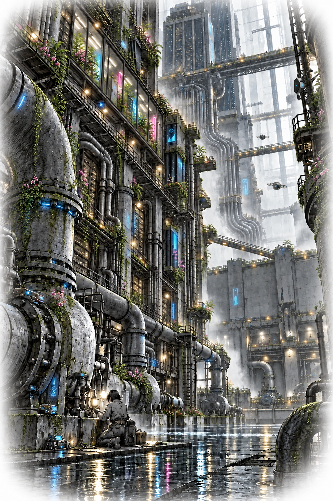

# Chapter 1
## Small Defect

Mara woke with her tongue against a tooth that should have been broken.

She moved it back and forth. Smooth enamel, a sharp new edge. She opened her eyes.

The ceiling above her was painted tram-depot green. A curtain hung around the narrow bed, with a gap at the foot.

A trolley rattled past the gap. One wheel knocked with each turn. Somewhere beyond the curtain, onions were frying.

She sat up too quickly. Her hand went past the bed rail and closed on air.

"A little to the left," Kite said.

The voice came from a small ceramic case hanging from the lamp beside her. She had known that voice for nine years. Mara reached again, watching her hand this time. The fingers were longer. There was no white notch across the knuckle where a slipping wrench had struck her seventeen years ago.

"What happened to my hand?"

"Your reach needs calibration. Dax has the orientation record. May I show you?"

Beyond the curtain someone laughed. Mara could remember eating an apple on the tram, worrying a bit of peel loose from her bad tooth. Yesterday morning. After that, nothing she could put a proper edge around.

Her wrist display waited on the bedside table. She picked it up and found a payment warning.

"What do we owe?"

"Mara."

"How much?"

Kite told her. She put her feet on the floor. Even her soles felt insufficiently used.

Dax, who ran the depot repair kitchen, came through the curtain with tea. He looked older than he had yesterday, and when he saw her standing he put the mug down with both hands.

"Sit a minute. Please."

"There's a pump repair job. I have to take it before two."

"The continuity group can wait for your sleeve maintenance contribution."

"Sleeve?"

"Your body," Dax said. "This one's new. The group paid for it."

She looked at her hands. The words passed through her like a dropped tool through dark water. Somewhere below, she knew, they would strike bottom.

"Eli's coming," Dax said. "We can go through the record with him."

"I'll wait for him." She looked up. "I can still do the job."

"That isn't in question."

"Then let me have something I know."

He rubbed his jaw. At last he said he would take her himself. They would do the balance checks first. No climbing, no live work, and if her new hands stopped where she expected them to keep moving, she was to tell him.

She agreed too quickly. He made her say it again.

* * *

The pump was earning four hundred and twelve credits an hour. Mara was earning nothing until she agreed it worked.

Dax had brought her to a drainage vault beneath Silt, the low district around the depot. She knelt beside the isolated shaft housing while he watched the lockout indicator. Brown water heaved below the sump grating. A strip on her wrist counted the minutes she had rented the diagnostic channel. Nine minutes, forty-three seconds. The charge beneath it rose more smoothly than the water.

"Again," Kite said.

"I heard it."

"You heard the pump. I would like to hear the washer."

She moved the contact probe a finger's width. Her filter collar caught the warm mist blowing off the cooling pipes. Kite's seed, the little ceramic case now hanging from her neck, tapped her breastbone. Its weight, at least, was right.

"There."

Three turns of the shaft on the test motor, four. A small blunt tick arrived between the larger beats.

"Bearing cage?"

"Possibly. I practiced separating overlapping vibrations while you were on the tram. That could also be a loose mounting clip."

"Yesterday?"

"Yesterday. Just after your checkpoint."

She held the probe still.

"You practiced on whose money?"

"Local computation. I became very slow at counting the stops."

Vesper, the corporation that allocated her repair jobs, compared the recording with its approved examples. VARIATION WITHIN SAFE ENVELOPE. REASSEMBLE AND RELEASE.

Mara requested an extension. Additional investigation, the service informed her, would be discretionary.

"Meaning unpaid."

Dax reached around her and checked the probe cable, giving her time to decide.

"Show me the cost of a cage failure," she said.

"For which party?" Kite asked.

She laughed once. It came out higher than she expected.

A human supervisor joined the channel. Behind his face a ceiling fan turned, and a child shouted somewhere outside the frame. He listened to the recording twice.

"It's below threshold," he said.

"At this load."

"That's the test load."

"High water's due in five days."

"I know when high water's due, Venn. I've got a ground-floor mother. Can you certify an immediate risk?"

An intermittent knock might last a month. It might end at the next restart. Kite offered an estimate, then crossed it out because the sample was too small.

"I can certify that the cover needs to come off."

The man rubbed his face. "Mark your exception. I can't give you the time."

He stayed on the channel while she broke the paint seal. She appreciated that more than she wanted to.

The bearing cage had a hairline crack along one pocket. Stationary, it almost disappeared. She wiped oil across it and flexed it gently; the line filled black.

The supervisor authorized a replacement. The first eighteen minutes remained discretionary. A new warning explained that dismantling without prior approval had lowered her completion score.

Beyond the mesh wall, a freight lift descended through the city. Its passing lamps lit the cavern underneath: concrete piers sinking into darkness, cooling pipes thick as tramcars, walkways that disappeared before reaching their other ends. This was only the outer service vault of the Stackhold above Intake Nine. She had worked around its edges since she was sixteen and had never seen the far wall.

Two people stood across the void. Their inspection lights looked like sparks caught in a drain.

"You learned something useful," she told Kite, packing the old bearing.

"Yes."

"Keep it."

"The practice is mine. The fault example belongs to this service record. I have separated them."

Dax held the gate open. Going through, she struck her unfamiliar elbow against the frame. It hurt with complete conviction.

* * *

Eli was waiting in the depot's recovery alcove. He rose when she entered, then stopped, his hands hanging awkwardly at his sides.

"Don't," she said.

"I haven't done anything."

She looked at his face. He was her younger brother, with the scar on his chin she remembered making, accidentally, with a toy crane. His face had not changed. Something in it had.

He sat back down. On the bedside table, his dismantled radio lay beside the tea she had left. He had brought it here to give his hands work.

Mara touched her new tooth.

"Tell me."

Kite asked permission to show her the record. This time she gave it.

There was a witness statement. Rook Street underpass. A gang collector demanding the key to her privately held repair skills instead of money, with two boys at his back to make asking mean something else. The statement gave the argument six lines and her death one.

"Last evening," Kite said. "The witness knew you. Your private checkpoint is from that morning. The continuity group held it under your instructions. You had authorized restoration if the body could not be saved."

"This body."

"This one was available," Eli said. His voice caught on available, and he began again. "Dax called them. We checked your consent."

Mara looked down at her hands. She remembered signing the directive years earlier, irritated by the number of separate permissions. Her parents' people had been particular about ownership. Down in the old streets, that was one of the ways they annoyed the government. She had thought it was another form for a disaster that happened to somebody else.

"Am I a copy?"

Kite was quiet long enough that she heard the trolley wheel in the kitchen.

"You are the current Mara," it said. "Your soul was restored from the checkpoint you owned. I recognize you. I cannot give you the day you lost."

Eli covered his face. She put her strange hand against his wrist, and he caught it.

A notice lit her display. Vesper wanted acknowledgment of the new continuity terms for Tomorrow, its city-service system, due to launch in five days.

Kite read them while she sat with her brother.

"There is a custody clause," it said at last. "It applies to running identities. Yours as well as mine."

Mara looked from the smooth skin of her hand to the small worn seed. She had been back in the world for six hours. Somebody had already found a cleaner way to take what she knew.

