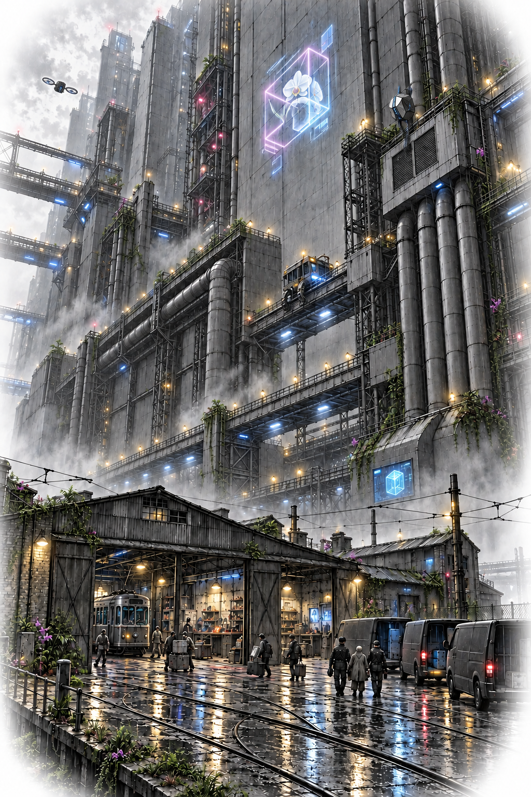

# Chapter 9
## The Cost of a Map

The sound came through the wall before it reached the door: a metal wheel passing over joints in the old service track.

Sef closed their eyes.

"The call was about taking the relay back," they said.

"How much time did they give you?" Mara asked.

"I thought we had until morning."

Eli was already at the relay. He checked its load, then the people working downstream. On the route wall, a food van moved toward the cold store with its last delivery. Two repair jobs remained open.

"Finish those," he said. "No new work."

There was a knock on the depot's street door, so ordinary that someone started to answer. Dax stopped them. He went himself.

Through the open leaves Mara saw two municipal enforcement officers and a Vesper field supervisor in a white impact helmet. The supervisor carried a folded seizure notice. Behind them, a service lift descended through the slot between the depot and the Stackhold's retaining wall, carrying four technicians down from a freight duct where Mara had never seen anybody walk.

The supervisor introduced herself as Kez and offered Dax the notice.

"Preservation of network equipment connected to impounded assets. No one needs to be hurt."

"Glad we've settled that," Dax said. He read with his finger. "This names a relay."

"And its associated records."

"You've brought a lot of lift for a relay."

Mara took Kite out of the shared tray. Its light had gone amber.

"My export is closed," it said. "Wake is reducing."

On the wall, chambers separated from one another. Each participating soul withdrew with its own learning and whatever small, permitted modules it had accepted. Wake left a signed account of unfinished jobs. Its combined voice told the van driver where to find a human dispatcher. Then the route wall went blank.

The technicians came through the rear shutters.

"That circuit is live," Eli told them.

One knelt beside the service junction without answering.

Eli crossed the floor and stood between him and the panel. "There is cooling on it. If you remove the feed, this room will contain hot cells and people. Listen for thirty seconds."

Kez called from the door. "Check his numbers."

They checked. Those thirty seconds became ninety. Mara used them to walk the seed trays to their owners. She wanted to scoop up everything herself, but people needed their own hands on their own lives. She pointed out cables. Tavi held a bag open for someone whose fingers shook too badly to manage its clasp.

Pell was at Dax's shoulder. He passed her a thick packet of wage envelopes.

"People should be paid," he said.

She looked at him and understood something Mara did not yet understand. She took the packet into the kitchen.

A technician photographed the benches. Another fitted a red custody collar around the relay's frame.

"Personal seeds leave with their owners," Kez said. "Anything integrated with the disputed unit remains."

"That includes half my kettle," Dax said.

"Then unplug it."

For a moment the absurdity almost rescued the room. The parcel worker gave a startled laugh. Then the technician at the junction cut the auxiliary supply before the separate cooling feed was ready.

The cooling pump stopped. Eli swore and reached for the switch that would put it on battery power. Within the relay, an already heat-softened fitting failed with a noise like a knuckle cracking. Water misted over the exposed boards.

Mara could have reached the cooling shutoff if she had been beside it. Instead she was carrying someone else's seed across the room.

She kept walking.

The relay's indicator strip went dark from bottom to top. Its last light trembled behind a sheet of water and disappeared.

* * *

Dax's workshop had never seemed expensive until strangers began tagging it.

The winding lathe. The pressure bench. The drawers of old connectors, sorted by a system Dax claimed was intuitive. A technician marked the soup boiler because it shared a cooling return with the relay. Tavi began emptying it into her food carriers while the technician objected.

"Do you want to preserve the soup?" she asked.

He looked at Kez.

"Let her take it."

Dax negotiated for a chest of hand tools. Then for a compact oven. He made Kez read the ownership plate on the checkpoint cradle, the depot's independent backup reader: bought outright by the tenant association, its debt cleared two years earlier. Mara unbolted it while he argued. The cradle went out wrapped in a kitchen blanket, its independent seed reader intact. He pointed out every independent piece of repair-kitchen equipment and demanded it be entered separately on the inventory. Outside, neighbours formed a line to carry the released items across the street. Nobody cheered. They handled the objects carefully, as if moving a household after a death.

One enforcement officer approached the desk.

"We require the operator register."

"There is a service log on the relay," Dax said. "Job numbers and responsible operators, as the contract requires."

"The associated personnel register."

"Not in that notice."

The officer held out his hand for Dax's tablet.

Dax put it face down beneath both palms. Mara saw then what Pell had carried away. Wage envelopes, with names and home addresses on the fronts, bundled around the paper sign-in sheets. The relay knew who had signed each job. It did not know everyone who had come to help, or where they slept. Dax was buying the time for that fact to leave the building.

"We can wait for a narrower order," he said.

"You can contest preservation afterward."

"Everyone keeps recommending afterward."

The second officer came over. Mara set down the tool chest.

Dax looked directly at her. "This is my decision. Finish carrying."

She hated him for saying exactly the thing she needed to hear.

They took his hands off the tablet. His chair fell sideways, making a much louder noise than his arrest. He said his full name for the recording, requested representation, and asked Pell's whereabouts. Mara told him she was outside.

"Good. Tell her the oven seal needs doing."

One officer waited while the other brought Dax's coat. They did not let him put it on. Mara watched him walk between them toward the lift, the coat folded over his bound wrists. Against the Stackhold's loading machinery he looked so small she could barely bear to recognize him.

She carried the tool chest out. Her unfamiliar shoulder shifted under the weight. She let the parcel worker take the other handle.

* * *

They met beneath a road ramp after dark. The kitchen's remaining equipment stood on borrowed trolleys. Rain dripped through a crack above the oven. Pell had counted everybody twice and arranged a lawyer's first call with money the Cooperative did not have.

Tavi had brought the tray of greens with the food carriers. There was no socket for its lamp under the ramp. She covered it against the cold spray and asked for a place on the next trolley. Losing the depot had taken their growing light as well as their roof.

A public screen across the road showed the depot shutters coming down. The caption called it a precaution against an unlicensed autonomous network. Behind the words, Mara saw herself carrying the chest. Her face looked furious. She wondered how many people would mistake that for evidence.

Sef waited until the last equipment carrier left.

"I gave them the culvert cache," they said. "The empty one below the freight duct. Its location and the old connection plan, in exchange for releasing the community controllers and relay."

Eli sat on an overturned bucket. "You told us the appeal worked."

"The appeal didn't work."

"That wasn't the question."

Sef nodded. Their elegant jacket was wet through at the shoulders. "I lied."

The cache had held abandoned casings and publicly licensed modules, nothing personal. Sef had thought Vesper would seize it, announce a result and release the equipment. They had known an old service passage connected the culvert to the depot's relay niche. On their map, flood doors blocked the passage. The depot's address had never been secret. Its rear connections were. Sef had given Vesper a route to the relay and a connection it could use to call the whole workshop associated equipment.

"They brought a lift above the doors," Mara said.

"Yes."

She remembered the little wheel moving behind the wall. All their screens, and a person had simply walked around the edge of the map.

"You could have asked us," Pell said.

"You would have said no."

Nobody answered. Sef seemed to hear the full shape of what they had said only after it was out.

Mara wanted the clean pleasure of sending them away. She had bought her own safety once with money her crew never knew about. Now she owed a criminal syndicate for work she would not finish. Disclosing it had not made it harmless. These choices were not equal. They did prevent her from pretending she could sort the room into people capable of betrayal and everyone else.

"You don't negotiate for us again," she said.

Pell turned toward her. "That is ours to decide."

Mara swallowed. "Then that's what I propose."

Eli wanted Sef off the work entirely. Pell wanted access to their records first. They settled on supervised technical work, no independent contacts, a review when they had a place to hold one. Sef offered Moth's private history as proof.

"No," Mara said. "Your messages about the bargain. Your decisions. Moth didn't make this deal."

From Sef's pocket, a quiet voice said, "Correct."

Pell took the records. No one touched Sef's shoulder.

The rain strengthened. Mara called up the district map on her cracked screen, then put it away.

"Show me somewhere you've actually been," she told Eli.

He looked toward the dark gulf beneath the Stackhold's southern span.

"There's the old tram switchhouse."

It hung below the industrial ducts on six steel rods, a maintenance room suspended in an excavated void. Far below it, walled return channels crossed among the foundations. The cooling circuits themselves stayed inside paired mains. Above it, power buses vanished into galleries that had been built by machines for machines. A human walkway reached the room from the obsolete tram alignment.

"Does it have power?" Pell asked.

"An independent tram feeder. If the cable still tests."

"Cooling?"

"Water. Plenty of water. Getting it is the trouble."

Mara looked at their oven, their boxed seeds, the tools they had saved. In the bright screen across the road, the depot became dangerous again.

"Then first we test the cable," she said.

